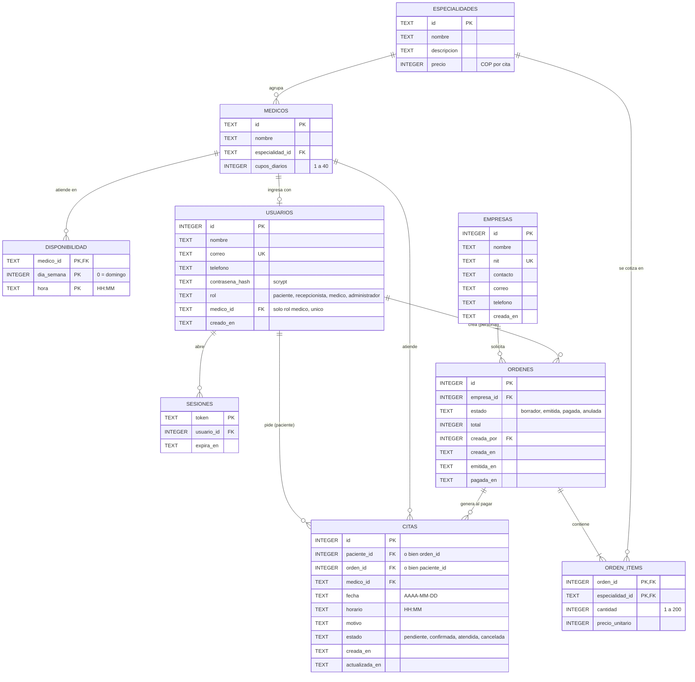
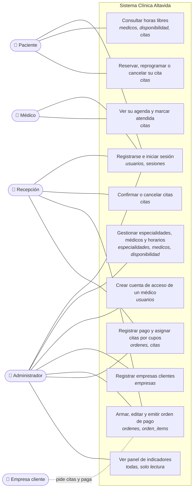
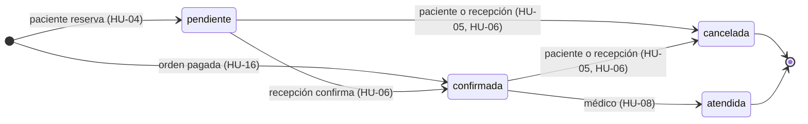
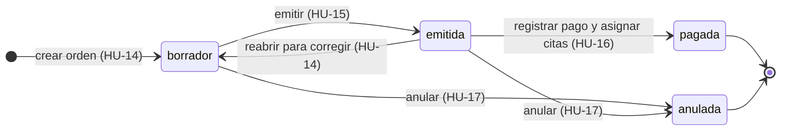

# Base de datos de Clínica Altavida

La clínica guarda todo en una base **relacional SQLite** (`servidor/datos/altavida.db`).
Las tablas se enlazan con claves foráneas, y SQLite las hace cumplir porque cada
conexión activa `PRAGMA foreign_keys = ON`. Así, por ejemplo, no puede existir una cita
con un médico inexistente ni un renglón de orden con una especialidad que no existe.

| Archivo | Qué hace |
| --- | --- |
| [`servidor/bd/esquema.sql`](../servidor/bd/esquema.sql) | El modelo completo: tablas, claves foráneas, `CHECK`, índices |
| [`servidor/bd/migraciones.js`](../servidor/bd/migraciones.js) | Lleva una base antigua a la versión vigente sin perder datos |
| [`servidor/bd/semillas.js`](../servidor/bd/semillas.js) | Catálogo y cuentas de demostración |
| [`servidor/bd/conexion.js`](../servidor/bd/conexion.js) | Abre la base y ofrece `enTransaccion()` |
| [`servidor/bd/valores.js`](../servidor/bd/valores.js) | Precio y cupos por defecto, compartidos con las rutas |

Versión visual para abrir en el navegador: [`docs/modelo-datos.html`](modelo-datos.html).

**Contenido:**
1. [Diagrama entidad-relación](#1-diagrama-entidad-relación)
2. [Reglas que la base hace cumplir](#2-reglas-que-la-base-hace-cumplir)
3. [Diagrama de casos de uso](#3-diagrama-de-casos-de-uso)
4. [Historias de usuario y su recorrido por la base](#4-historias-de-usuario-y-su-recorrido-por-la-base)
5. [Versiones y migraciones](#5-versiones-y-migraciones)
6. [Consultar la base](#6-consultar-la-base)

---

## 1. Diagrama entidad-relación



### Cómo leer las relaciones

| Relación | Cardinalidad | Clave foránea | Al borrar el padre |
| --- | --- | --- | --- |
| Especialidad → médicos | 1 a muchos | `medicos.especialidad_id` | Se impide |
| Médico → franjas de atención | 1 a muchos | `disponibilidad.medico_id` | Se borran sus franjas |
| Médico → cuenta de acceso | 1 a 0 o 1 | `usuarios.medico_id` (índice único) | Se impide |
| Usuario → sesiones | 1 a muchos | `sesiones.usuario_id` | Se borran sus sesiones |
| Paciente → citas | 1 a muchos | `citas.paciente_id` | Se impide |
| Médico → citas | 1 a muchos | `citas.medico_id` | Se impide |
| Empresa → órdenes | 1 a muchos | `ordenes.empresa_id` | Se impide |
| Usuario del personal → órdenes que creó | 1 a muchos | `ordenes.creada_por` | Se impide |
| Orden → renglones | 1 a muchos | `orden_items.orden_id` | Se borran sus renglones |
| Especialidad → renglones | 1 a muchos | `orden_items.especialidad_id` | Se impide |
| Orden pagada → citas asignadas | 1 a muchos | `citas.orden_id` | Se impide |

`orden_items` es la tabla puente de la relación **muchos a muchos** entre órdenes y
especialidades: una orden pide varias especialidades y una especialidad aparece en
muchas órdenes. Su clave primaria es el par `(orden_id, especialidad_id)`.

## 2. Reglas que la base hace cumplir

La base valida estas reglas por sí misma, aunque el servidor tenga un error:

| Regla | Cómo |
| --- | --- |
| Un horario de un médico no puede tener dos citas activas | Índice único parcial `ux_citas_horario_activo (medico_id, fecha, horario) WHERE estado <> 'cancelada'` |
| Una cita es de un paciente o de una orden de empresa | `CHECK (paciente_id IS NOT NULL OR orden_id IS NOT NULL)` |
| Un médico tiene como máximo una cuenta | Índice único parcial `ux_usuarios_medico` |
| Solo las cuentas con rol médico se enlazan a un médico | `CHECK (medico_id IS NULL OR rol = 'medico')` |
| Un correo, una cuenta; un NIT, una empresa | `UNIQUE` en `usuarios.correo` y `empresas.nit` |
| Estados y roles válidos | `CHECK (estado IN (...))`, `CHECK (rol IN (...))` |
| Cupos, cantidades y precios en rango | `CHECK (cupos_diarios BETWEEN 1 AND 40)`, `CHECK (cantidad BETWEEN 1 AND 200)`, `CHECK (precio >= 0)` |
| Una especialidad no se repite en una orden | Clave primaria `(orden_id, especialidad_id)` |
| Operaciones de varios pasos (pagar y asignar citas) | `enTransaccion()`: se guarda todo o nada |

Índices de apoyo para las consultas frecuentes: `ix_medicos_especialidad`,
`ix_sesiones_usuario`, `ix_ordenes_empresa`, `ix_citas_paciente` e `ix_citas_orden`.

## 3. Diagrama de casos de uso

Quién usa cada parte del sistema y qué tablas toca cada caso de uso.



## 4. Historias de usuario y su recorrido por la base

Cada historia dice quién la pide, qué necesita y para qué. Debajo están sus criterios de
aceptación y las tablas que **lee** (L) o **escribe** (E). Las restricciones citadas son
las de la sección 2.

### Paciente

**HU-01 · Crear mi cuenta**
> Como **paciente**, quiero registrarme con mi correo, para pedir citas sin llamar a la clínica.

- El registro público siempre crea el rol `paciente`; el rol nunca llega del formulario.
- Un correo solo puede tener una cuenta (`UNIQUE usuarios.correo`).
- La contraseña se guarda como hash scrypt, nunca en texto plano.
- Tablas: `usuarios` (E).

**HU-02 · Iniciar sesión**
> Como **usuario de cualquier rol**, quiero ingresar con mi correo y contraseña, para llegar a mi página.

- Al ingresar se crea una sesión con vencimiento; al salir se borra.
- Cada rol entra solo a su área (las demás responden 403).
- Tablas: `usuarios` (L), `sesiones` (E).

**HU-03 · Ver horas libres**
> Como **paciente**, quiero ver qué horas siguen libres por especialidad, médico y día, para elegir una que de verdad esté disponible.

- Solo aparecen especialidades con médicos que tienen horario.
- Una hora está libre si está en la disponibilidad del médico ese día de la semana, no tiene una cita activa, no ha pasado y el médico no ha llenado sus cupos del día.
- La agenda pública no muestra datos de pacientes.
- Tablas: `especialidades`, `medicos`, `disponibilidad`, `citas` (L).

**HU-04 · Reservar una cita**
> Como **paciente**, quiero reservar la hora que elegí, para que nadie más la ocupe.

- La cita nace en estado `pendiente` y queda a mi nombre (`citas.paciente_id`).
- Si dos pacientes piden la misma hora, la base acepta solo la primera (`ux_citas_horario_activo`).
- No se aceptan fechas pasadas ni días en que el médico no atiende.
- Tablas: `disponibilidad` (L), `citas` (L/E).

**HU-05 · Reprogramar o cancelar mi cita**
> Como **paciente**, quiero cambiar la hora o cancelar mi cita, para no perderla si me surge algo.

- Solo mis propias citas, y solo mientras estén `pendiente` o `confirmada`.
- Cancelar libera la hora al instante, porque el índice único ignora las citas canceladas.
- Tablas: `disponibilidad` (L), `citas` (L/E).

### Recepción

**HU-06 · Confirmar o cancelar solicitudes**
> Como **recepcionista**, quiero confirmar o cancelar las citas que piden los pacientes, para que la clínica sepa a quién espera.

- Solo se confirman citas `pendiente`; se cancelan las `pendiente` o `confirmada`.
- Cada cambio actualiza `citas.actualizada_en`.
- Tablas: `usuarios`, `medicos` (L), `citas` (L/E).

### Médico

**HU-07 · Ver mi agenda**
> Como **médico**, quiero ver mis próximas citas, para preparar la consulta.

- Veo solo las citas de mi ficha (`usuarios.medico_id` → `citas.medico_id`), de hoy en adelante y sin las canceladas.
- Tablas: `usuarios`, `citas` (L).

**HU-08 · Marcar una consulta como atendida**
> Como **médico**, quiero marcar como atendida la consulta que realicé, para que quede en el historial.

- Solo citas `confirmada` de mi propia agenda.
- Tablas: `citas` (L/E).

### Administración

**HU-09 · Gestionar el catálogo**
> Como **administrador**, quiero crear especialidades y médicos y definir sus horarios, para que los pacientes puedan agendar.

- Un médico pertenece a una especialidad existente (`medicos.especialidad_id`).
- Sus horarios son franjas día-hora sin repetir (clave primaria de `disponibilidad`).
- Cambiar un horario no modifica las citas ya agendadas.
- Tablas: `especialidades`, `medicos`, `disponibilidad` (E).

**HU-10 · Fijar los cupos diarios de un médico**
> Como **administrador**, quiero definir cuántos pacientes atiende un médico por día, para no sobrecargarlo.

- Entre 1 y 40 (`CHECK cupos_diarios`); por defecto 4.
- Lo respetan tanto las reservas de pacientes como la asignación de órdenes.
- Tablas: `medicos` (E).

**HU-11 · Dar acceso a un médico**
> Como **administrador**, quiero crear la cuenta de acceso de cada médico, para que vea su propia agenda.

- Se crea junto con el médico o después, desde la tabla de médicos.
- Un médico tiene como máximo una cuenta (`ux_usuarios_medico`), y solo una cuenta con rol médico se enlaza a un médico (`CHECK`).
- Médico y cuenta se guardan en una transacción: si falla uno, no queda ninguno.
- Tablas: `medicos`, `usuarios` (E).

**HU-12 · Ver el panel de indicadores**
> Como **administrador**, quiero un resumen de citas, ocupación y órdenes, para saber cómo va la clínica.

- Muestra:
  - citas por estado;
  - ocupación de los próximos 7 días frente a la capacidad;
  - órdenes por estado, y montos pagados y por cobrar;
  - avisos: especialidades sin médicos y médicos sin horario.
- Tablas: `especialidades`, `medicos`, `disponibilidad`, `citas`, `ordenes` (L).

### Empresas clientes (las gestiona recepción o administración)

**HU-13 · Registrar una empresa cliente**
> Como **personal de la clínica**, quiero registrar las empresas que piden citas para sus empleados, para emitirles órdenes de pago.

- El NIT no se repite (`UNIQUE empresas.nit`).
- Tablas: `empresas` (E).

**HU-14 · Cotizar y editar una orden**
> Como **personal de la clínica**, quiero armar una orden con las especialidades y cantidades que pide la empresa, para cotizarle el valor.

- La orden nace en `borrador` y solo se edita en ese estado.
- Una especialidad aparece una sola vez por orden (clave primaria de `orden_items`).
- Solo se piden especialidades con médicos que tengan horario.
- Una orden `emitida` se puede reabrir: vuelve a `borrador` para corregirla.
- Tablas: `especialidades`, `medicos`, `disponibilidad`, `empresas` (L), `ordenes`, `orden_items` (E).

**HU-15 · Emitir la orden de pago**
> Como **personal de la clínica**, quiero emitir la orden con los precios de cada especialidad, para enviársela a la empresa.

- Al emitir se congelan los precios (`orden_items.precio_unitario`) y el total (`ordenes.total`).
- Tablas: `especialidades` (L), `ordenes`, `orden_items` (E).

**HU-16 · Registrar el pago y asignar las citas**
> Como **personal de la clínica**, quiero registrar el pago de la empresa, para que el sistema le asigne fechas según la capacidad de los médicos.

- Las citas se reparten desde mañana entre los médicos de cada especialidad, respetando sus horarios y cupos diarios. Si un día se llena, pasan al siguiente.
- Las citas asignadas nacen `confirmada` y quedan enlazadas a la orden (`citas.orden_id`) en lugar de a un paciente.
- Todo o nada: si no alcanzan los cupos en 120 días, no se asigna ninguna cita y la orden sigue `emitida`.
- Tablas: `orden_items`, `medicos`, `disponibilidad` (L), `citas`, `ordenes` (E).

**HU-17 · Anular una orden**
> Como **personal de la clínica**, quiero anular una orden que la empresa ya no quiere, para que no quede pendiente de cobro.

- Solo órdenes `borrador` o `emitida`; una orden pagada no se anula.
- Tablas: `ordenes` (E).

### Matriz historia × tabla

L = lee, E = escribe.

| Historia | especialidades | medicos | disponibilidad | usuarios | sesiones | citas | empresas | ordenes | orden_items |
| --- | :-: | :-: | :-: | :-: | :-: | :-: | :-: | :-: | :-: |
| HU-01 Registro | | | | E | | | | | |
| HU-02 Ingreso | | | | L | E | | | | |
| HU-03 Horas libres | L | L | L | | | L | | | |
| HU-04 Reservar | | | L | | | E | | | |
| HU-05 Reprogramar o cancelar | | | L | | | E | | | |
| HU-06 Confirmar (recepción) | | L | | L | | E | | | |
| HU-07 Agenda del médico | | | | L | | L | | | |
| HU-08 Atender | | | | | | E | | | |
| HU-09 Catálogo | E | E | E | | | | | | |
| HU-10 Cupos | | E | | | | | | | |
| HU-11 Cuenta del médico | | E | | E | | | | | |
| HU-12 Panel | L | L | L | | | L | | L | |
| HU-13 Empresa | | | | | | | E | | |
| HU-14 Cotizar | L | L | L | | | | L | E | E |
| HU-15 Emitir | L | | | | | | | E | E |
| HU-16 Pagar y asignar | | L | L | | | E | | E | L |
| HU-17 Anular | | | | | | | | E | |

### Ciclo de vida de una cita



### Ciclo de vida de una orden



## 5. Versiones y migraciones

La versión del esquema se guarda en la propia base (`PRAGMA user_version`). Al arrancar,
el servidor:

1. Si la base es nueva, ejecuta `esquema.sql` y la marca con la última versión.
2. Si es antigua, aplica en orden las migraciones pendientes y después `esquema.sql`,
   que crea lo que falte. Todo ocurre en una sola transacción.
3. Comprueba con `PRAGMA foreign_key_check` que no queden referencias rotas.
4. Carga los datos de demostración que falten (`semillas.js`).

| Versión | Cambio |
| --- | --- |
| 1 | `usuarios.medico_id`: la cuenta de un médico se enlaza con su ficha |
| 2 | Órdenes de empresas: `especialidades.precio`, `medicos.cupos_diarios`, `citas.orden_id` |
| 3 | Índices de claves foráneas y una sola cuenta por médico |

Para agregar un cambio al modelo: se edita `esquema.sql` (para las bases nuevas) y se
agrega la migración siguiente en `migraciones.js` (para las bases existentes).

## 6. Consultar la base

```bash
npm run reiniciar-bd    # borra la base local; la próxima vez se crea de nuevo con la demostración
```

Para ver los datos se puede abrir `servidor/datos/altavida.db` con cualquier visor de
SQLite (por ejemplo, la extensión *SQLite Viewer* de VS Code o *DB Browser for SQLite*).
