# Clínica Altavida — Contextualización con DDD y Event Storming

Este documento describe el **dominio** del sistema de gestión de citas de
Clínica Altavida usando **Domain-Driven Design (DDD)** y la técnica de
**Event Storming**. Muestra qué ocurre en el negocio, quién lo provoca, qué
reglas se cumplen y cómo se divide el sistema en contextos.

**Contenido**

1. [Visión del dominio](#1-visión-del-dominio)
2. [Leyenda del Event Storming](#2-leyenda-del-event-storming)
3. [Big Picture: línea de tiempo de eventos](#3-big-picture-línea-de-tiempo-de-eventos)
4. [Process Level: cada flujo en detalle](#4-process-level-cada-flujo-en-detalle)
5. [Ciclo de vida de una Cita y de una Orden](#5-ciclo-de-vida-de-una-cita-y-de-una-orden)
6. [Agregados e invariantes](#6-agregados-e-invariantes)
7. [Bounded Contexts y Context Map](#7-bounded-contexts-y-context-map)
8. [Lenguaje ubicuo (glosario)](#8-lenguaje-ubicuo-glosario)
9. [Hotspots: preguntas abiertas](#9-hotspots-preguntas-abiertas)
10. [Del modelo al código](#10-del-modelo-al-código)

> **Estado del alcance.** Las etapas 1 a 3 implementan el flujo del
> **paciente**, y hay una primera versión de los flujos de **recepción**,
> **médico** y **administración**, con reglas provisionales a la espera de las
> decisiones abiertas (sección 9). La etapa 4 agrega las **órdenes de
> empresas** (cotización, orden de pago y asignación automática de citas por
> **cupos diarios**), las **empresas clientes**, la **agenda pública** de la
> portada y el **panel de administración**. En las tablas se marcan así:
> ✅ implementado · 🟡 implementado con regla provisional · 🕓 pendiente.

---

## 1. Visión del dominio

**Problema:** coordinar las citas médicas de varias especialidades sin
llamadas ni mensajes cruzados, evitando que dos pacientes ocupen el mismo
horario de un médico.

**Dominio principal (Core Domain):** el **Agendamiento de Citas**: reservar,
reprogramar y cancelar citas respetando la disponibilidad real de cada
médico. Es lo que diferencia al sistema y donde están las reglas más
importantes.

| Tipo de subdominio             | Subdominio            | Por qué                                                                               |
| ------------------------------ | --------------------- | -------------------------------------------------------------------------------------- |
| **Core** (principal)     | Agendamiento de Citas | Es el valor del sistema: disponibilidad real y cero dobles reservas.                   |
| **Supporting** (soporte) | Catálogo Clínico    | Especialidades, médicos y horarios de atención; necesarios, pero no diferenciadores. |
| **Supporting** (soporte) | Atención Médica     | Agenda del día del médico y registro de citas atendidas.                             |
| **Supporting** (soporte) | Órdenes de Empresas | Venta de citas por lotes a empresas: cotización, orden de pago y asignación por cupos. Usa el Core, no lo reemplaza. |
| **Generic** (genérico)  | Identidad y Acceso    | Registro, inicio de sesión y roles: es igual en cualquier sistema.                    |

### Actores

| Actor                          | Rol en el dominio                                                     | Estado |
| ------------------------------ | --------------------------------------------------------------------- | ------ |
| 🧑 **Paciente**          | Se registra, solicita, reprograma y cancela sus citas.                | ✅     |
| 🧑‍💼 **Recepcionista** | Gestiona las citas: las confirma o cancela.                           | 🟡     |
| 🩺 **Médico**           | Consulta su agenda y marca las citas como atendidas.                  | ✅     |
| 🛠️ **Administrador**   | Gestiona especialidades, médicos, horarios y cupos diarios; registra empresas clientes; ve el panel; también gestiona órdenes. | ✅     |
| 🏢 **Empresa cliente**  | Actor externo: pide citas para sus empleados, recibe la orden de pago y paga. No usa la aplicación. | ✅     |
| ⚙️ **Sistema**         | Aplica las políticas automáticas (liberar horarios, validar cupos, asignar las citas de una orden pagada). | ✅     |

La **recepcionista** además arma las órdenes de empresas (las mismas acciones que el administrador en esa parte).

---

## 2. Leyenda del Event Storming

Event Storming usa notas adhesivas de colores. En los diagramas de este
documento se respetan los colores clásicos:

| Color       | Elemento                             | Qué representa                                               | Cómo se escribe                       |
| ----------- | ------------------------------------ | ------------------------------------------------------------- | -------------------------------------- |
| 🟧 Naranja  | **Evento de dominio**          | Algo importante que **ya ocurrió**                     | En pasado: *Cita solicitada*         |
| 🟦 Azul     | **Comando**                    | Una intención o acción que provoca un evento                | En infinitivo: *Solicitar cita*      |
| 🟨 Amarillo | **Actor** / **Agregado** | Quién ejecuta el comando / la entidad que protege las reglas | *Paciente* / *Cita*                |
| 🟪 Lila     | **Política**                  | Regla automática: "cuando ocurre X, entonces Y"              | *Cuando se cancela, liberar horario* |
| 🟩 Verde    | **Modelo de lectura**          | La información que el actor ve para decidir                  | *Horarios disponibles*               |
| 🟥 Rosa     | **Hotspot**                    | Duda, riesgo o regla aún sin definir                         | *¿Plazo para cancelar?*             |

```mermaid
flowchart LR
    A["🟨 Actor"]:::actor --> C["🟦 Comando"]:::comando --> G["🟨 Agregado"]:::agregado --> E["🟧 Evento"]:::evento
    E --> P["🟪 Política"]:::politica --> C2["🟦 Comando siguiente"]:::comando
    R["🟩 Modelo de lectura"]:::lectura -. informa .-> A

    classDef evento fill:#F5A623,stroke:#B5651D,color:#1A1A1A
    classDef comando fill:#4A90E2,stroke:#2C5A8C,color:#FFFFFF
    classDef actor fill:#FFE066,stroke:#B39A2B,color:#1A1A1A
    classDef agregado fill:#FFF3B0,stroke:#B39A2B,color:#1A1A1A
    classDef politica fill:#C39BD3,stroke:#7D3C98,color:#1A1A1A
    classDef lectura fill:#82E0AA,stroke:#239B56,color:#1A1A1A
```

---

## 3. Big Picture: línea de tiempo de eventos

Primer paso del Event Storming: **todos los eventos del dominio, en orden
cronológico**, de izquierda a derecha.

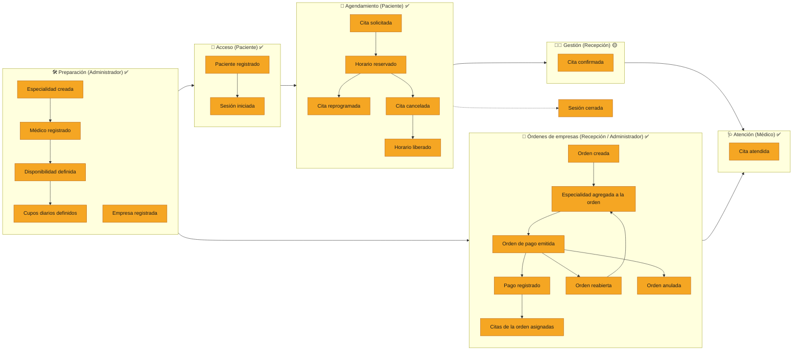

> Todos los eventos del recorrido ya tienen una primera versión implementada.
> El catálogo se crea con **datos de demostración** al iniciar la base de datos
> y el administrador puede ampliarlo desde la aplicación.

### Catálogo de eventos de dominio

| #  | Evento 🟧                         | Lo provoca                        | Datos que lleva                           | Estado |
| -- | --------------------------------- | --------------------------------- | ----------------------------------------- | ------ |
| 1  | **Especialidad creada**     | Administrador                     | id, nombre                                | ✅     |
| 2  | **Médico registrado**      | Administrador                     | id, nombre, especialidad                  | ✅     |
| 3  | **Disponibilidad definida** | Administrador                     | médico, día de la semana, horas         | ✅     |
| 4  | **Paciente registrado**     | Paciente                          | nombre, correo, teléfono                 | ✅     |
| 5  | **Sesión iniciada**        | Paciente                          | usuario, vencimiento (8 h)                | ✅     |
| 6  | **Cita solicitada**         | Paciente                          | paciente, médico, fecha, horario, motivo | ✅     |
| 7  | **Horario reservado**       | Sistema (política)               | médico, fecha, horario                   | ✅     |
| 8  | **Cita reprogramada**       | Paciente                          | cita, nuevo médico/fecha/horario         | ✅     |
| 9  | **Cita cancelada**          | Paciente o Recepcionista | cita                                      | ✅     |
| 10 | **Horario liberado**        | Sistema (política)               | médico, fecha, horario                   | ✅     |
| 11 | **Cita confirmada**         | Recepcionista                     | cita                                      | 🟡     |
| 12 | **Cita atendida**           | Médico                           | cita                                      | ✅     |
| 13 | **Sesión cerrada**         | Paciente                          | usuario                                   | ✅     |
| 14 | **Cupos diarios definidos** | Administrador                    | médico, pacientes por día (1–40)          | ✅     |
| 15 | **Empresa registrada**      | Administrador o Recepcionista    | nombre, NIT, contacto, correo, teléfono   | ✅     |
| 16 | **Orden creada**            | Recepcionista o Administrador    | empresa (queda en borrador)               | ✅     |
| 17 | **Especialidad agregada a la orden** | Recepcionista o Administrador | orden, especialidad, cantidad de citas | ✅     |
| 18 | **Orden de pago emitida**   | Recepcionista o Administrador    | orden, precios fijados, total             | ✅     |
| 19 | **Orden reabierta**         | Recepcionista o Administrador    | orden (vuelve a borrador para corregirla) | ✅     |
| 20 | **Pago registrado**         | Recepcionista o Administrador    | orden                                     | 🟡     |
| 21 | **Citas de la orden asignadas** | Sistema (política)           | orden, médico, fecha y hora de cada cita  | ✅     |
| 22 | **Orden anulada**           | Recepcionista o Administrador    | orden (solo antes del pago)               | ✅     |

---

## 4. Process Level: cada flujo en detalle

Segundo paso: para cada flujo se agrega **quién** actúa, **qué comando**
ejecuta, **qué ve** para decidir, **qué agregado** valida las reglas y **qué
políticas** se disparan.

### 4.1 Registro e inicio de sesión ✅

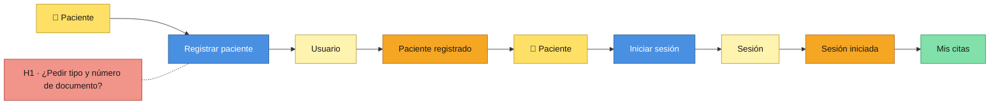

| Comando 🟦         | Reglas que se validan                                                                                                  | Evento 🟧 si tiene éxito | Si falla                               |
| ------------------ | ---------------------------------------------------------------------------------------------------------------------- | ------------------------- | -------------------------------------- |
| Registrar paciente | Nombre ≥ 3 letras · correo válido y **único** · teléfono de 7 a 15 dígitos · contraseña ≥ 8 caracteres | Paciente registrado       | "Ya existe una cuenta con este correo" |
| Iniciar sesión    | Correo y contraseña coinciden (hash scrypt)                                                                           | Sesión iniciada          | "Correo o contraseña incorrectos"     |
| Cerrar sesión     | —                                                                                                                     | Sesión cerrada           | —                                     |

### 4.2 Solicitar una cita ✅ (flujo principal)

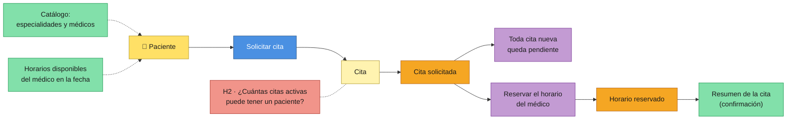

**Reglas del comando *Solicitar cita*:**

1. El médico pertenece a la especialidad elegida.
2. La fecha no está en el pasado.
3. El médico atiende ese **día de la semana**.
4. El horario está dentro de la disponibilidad del médico, **no está ocupado**
   por otra cita activa y, si la fecha es hoy, no ya pasó.
5. El médico **no ha completado sus cupos diarios** ese día (citas activas de
   pacientes y de empresas cuentan igual).
6. El motivo es opcional (máximo 300 caracteres).

Solo se ofrecen **especialidades agendables**: las que tienen al menos un médico
con horario. Las demás existen en el catálogo pero no aparecen para agendar.

### 4.3 Reprogramar y cancelar ✅

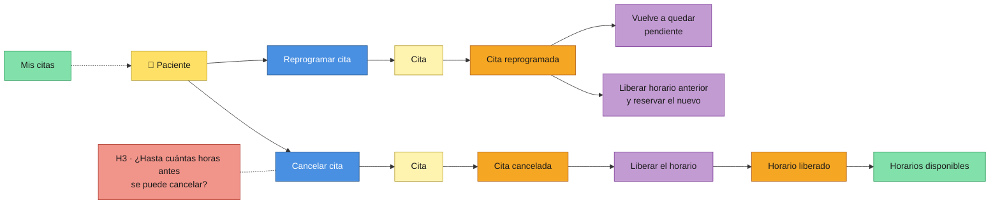

Solo se pueden reprogramar o cancelar las citas en estado **pendiente** o
**confirmada**. Reprogramar lo hace únicamente el paciente dueño de la cita;
cancelar también puede hacerlo la recepcionista.

### 4.4 Gestión de recepción y atención médica 🟡

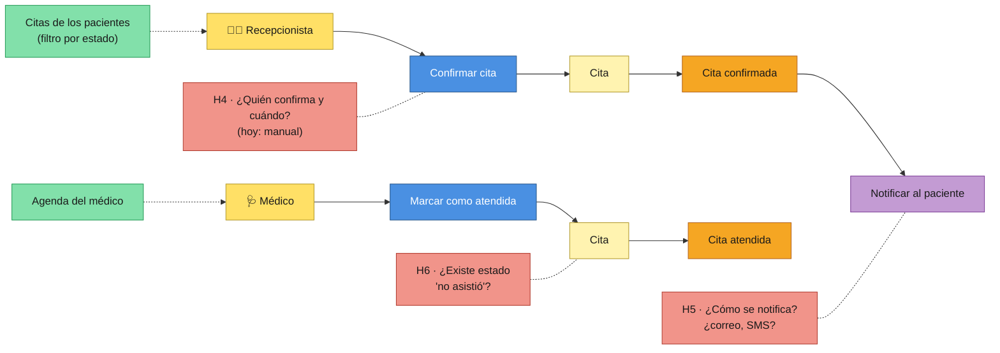

**Implementación actual (primera versión).** La recepcionista ve las citas de todos
los pacientes con filtro por estado (no solo las del día), confirma las pendientes y
cancela las activas. El médico ve sus citas desde hoy, sin las canceladas, y marca
como atendida solo una cita confirmada de su propia agenda. La notificación al
paciente (H5) sigue pendiente.

### 4.5 Órdenes de empresas ✅ (etapa 4)

Una **empresa cliente** pide citas para sus empleados por especialidad. La
recepcionista o el administrador arma la **orden**, la cotiza, emite la **orden
de pago** para la empresa y, cuando la empresa paga, el sistema **asigna las
citas** según la capacidad de los médicos.

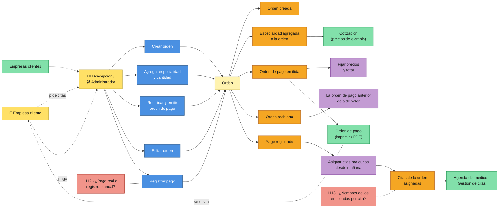

| Comando 🟦 | Reglas que se validan | Evento 🟧 si tiene éxito | Si falla |
| --- | --- | --- | --- |
| Registrar empresa | Nombre de 3 a 100 caracteres · NIT **único** (números, puntos y guion) · contacto · correo válido · teléfono de 7 a 15 dígitos | Empresa registrada | "Ya existe una empresa con ese NIT" |
| Crear orden | La empresa existe | Orden creada (borrador) | "Selecciona una empresa" |
| Cambiar empresa de la orden | Solo en **borrador** | — (corrige la orden) | 409 |
| Agregar especialidad / cambiar cantidad | Solo en **borrador** · cantidad de 1 a 200 · especialidad no repetida · la especialidad tiene médicos con horario | Especialidad agregada a la orden | "Esa especialidad aún no tiene médicos con horarios de atención" |
| Rectificar y emitir | Solo en **borrador** · al menos una especialidad | Orden de pago emitida | "Agrega al menos una especialidad" |
| Editar orden (reabrir) | Solo **emitida** (una pagada ya tiene citas asignadas) | Orden reabierta | "Una orden pagada no se puede editar" |
| Registrar pago | Solo **emitida** · hay cupos para **todas** las citas en los próximos 120 días | Pago registrado → Citas de la orden asignadas | "No hay cupos suficientes de … (faltan N)"; no se asigna nada |
| Anular orden | Solo **borrador** o **emitida** | Orden anulada | "Solo se pueden anular órdenes que aún no se han pagado" |

**Política de asignación por cupos** (`asignarRenglon()` en `servidor/asignacion.js`):

1. Se recorren los días desde **mañana**, hasta 120 días.
2. En cada día se reparte **por turnos** entre los médicos de la especialidad:
   cada médico da su primera hora libre, luego el siguiente, y así.
3. Un médico no recibe más citas cuando llega a sus **cupos diarios** o se queda
   sin horas libres; entonces se sigue con otro médico o con el día siguiente.
4. Cada cita nace **confirmada** (ya está pagada) y su motivo indica la orden:
   "Orden N.º 3 · Empresa · cita 2 de 5".
5. Todo ocurre en **una transacción**: o se asignan todas las citas y la orden
   queda pagada, o no cambia nada.

### 4.6 Agenda pública y preselección ✅ (etapa 4)

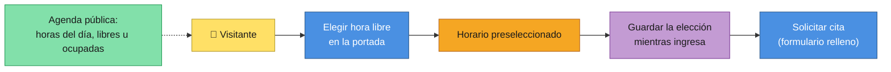

La portada muestra la agenda real sin iniciar sesión (`GET /api/agenda-publica`):
solo dice si cada hora está libre u ocupada, **nunca** quién la ocupa. La
preselección no reserva nada: vive en el navegador (`sessionStorage`) y la cita
se crea con las reglas normales de *Solicitar cita* (sección 4.2).

### 4.7 Panel de administración ✅ (etapa 4)

Es un **modelo de lectura** (no cambia nada): reúne en una pantalla lo que el
administrador necesita para decidir.

| Bloque del panel | Para decidir… |
| --- | --- |
| **Requiere atención:** especialidades sin médicos con horario, médicos sin horario, citas pendientes de confirmar | qué corregir en el catálogo o pedir a recepción |
| **Citas:** de hoy, de los próximos 7 días y total por estado | cómo viene la demanda |
| **Órdenes:** monto pagado, por cobrar (emitidas) y órdenes por estado | qué cobrar a las empresas |
| **Ocupación de los próximos 7 días:** citas frente a cupos por médico | a quién ampliar cupos u horarios |

### Resumen de comandos

| Comando 🟦             | Actor                    | Agregado     | Evento 🟧                            | Estado  |
| ---------------------- | ------------------------ | ------------ | ------------------------------------ | ------- |
| Registrar paciente     | Paciente                 | Usuario      | Paciente registrado                  | ✅      |
| Iniciar sesión        | Paciente                 | Sesión      | Sesión iniciada                     | ✅      |
| Cerrar sesión         | Paciente                 | Sesión      | Sesión cerrada                      | ✅      |
| Solicitar cita         | Paciente                 | Cita         | Cita solicitada → Horario reservado | ✅      |
| Reprogramar cita       | Paciente                 | Cita         | Cita reprogramada                    | ✅      |
| Cancelar cita          | Paciente / Recepcionista | Cita         | Cita cancelada → Horario liberado   | ✅ / 🟡 |
| Confirmar cita         | Recepcionista            | Cita         | Cita confirmada                      | 🟡      |
| Marcar como atendida   | Médico                  | Cita         | Cita atendida                        | ✅      |
| Crear especialidad     | Administrador            | Especialidad | Especialidad creada                  | ✅      |
| Registrar médico      | Administrador            | Médico      | Médico registrado                   | ✅      |
| Definir disponibilidad | Administrador            | Médico      | Disponibilidad definida              | ✅      |
| Definir cupos diarios  | Administrador            | Médico      | Cupos diarios definidos              | ✅      |
| Registrar / corregir empresa | Administrador / Recepcionista | Empresa | Empresa registrada            | ✅      |
| Crear orden            | Recepcionista / Administrador | Orden   | Orden creada                         | ✅      |
| Agregar especialidad a la orden | Recepcionista / Administrador | Orden | Especialidad agregada a la orden | ✅    |
| Rectificar y emitir    | Recepcionista / Administrador | Orden   | Orden de pago emitida                | ✅      |
| Editar orden (reabrir) | Recepcionista / Administrador | Orden   | Orden reabierta                      | ✅      |
| Registrar pago         | Recepcionista / Administrador | Orden   | Pago registrado → Citas de la orden asignadas | 🟡 |
| Anular orden           | Recepcionista / Administrador | Orden   | Orden anulada                        | ✅      |

### Políticas 🟪

| Política              | Cuando…                          | Entonces…                                                  | Estado |
| ---------------------- | --------------------------------- | ----------------------------------------------------------- | ------ |
| Cita nueva pendiente   | se solicita una cita              | queda en estado **pendiente**                         | ✅     |
| Reserva de horario     | se solicita o reprograma una cita | el horario queda **ocupado** para ese médico y fecha | ✅     |
| Reprogramar reinicia   | se reprograma una cita            | vuelve a **pendiente** (requiere nueva confirmación) | ✅     |
| Liberación de horario | se cancela una cita               | el horario vuelve a estar **disponible**              | ✅     |
| Notificación          | se confirma una cita              | se avisa al paciente                                        | 🕓     |
| Capacidad diaria      | se solicita o asigna una cita     | si el médico completó sus **cupos diarios**, ese día no tiene horas libres | ✅ |
| Solo especialidades agendables | se muestra el catálogo para agendar | se ocultan las especialidades sin médicos con horario | ✅ |
| Precio fijo al emitir | se emite la orden de pago         | cada renglón guarda su precio y la orden su total           | ✅     |
| Reabrir invalida      | se edita una orden emitida        | vuelve a **borrador**; la orden de pago anterior deja de valer y los precios se recalculan al volver a emitir | ✅ |
| Asignación por cupos  | se registra el pago de una orden  | se asignan todas sus citas desde mañana, por turnos entre médicos, respetando horario y cupos; nacen **confirmadas** | ✅ |
| Todo o nada           | no alcanzan los cupos para una orden | no se asigna ninguna cita y la orden sigue emitida        | ✅     |

### Modelos de lectura 🟩

| Modelo de lectura                                            | Lo usa        | Para decidir…                     | Estado |
| ------------------------------------------------------------ | ------------- | ---------------------------------- | ------ |
| Catálogo (especialidades y médicos con días de atención) | Paciente      | qué especialidad y médico elegir | ✅     |
| Horarios disponibles                                         | Paciente      | qué horario reservar              | ✅     |
| Resumen de la cita                                           | Paciente      | verificar lo que solicitó         | ✅     |
| Mis citas (con filtro por estado)                            | Paciente      | qué cita reprogramar o cancelar   | ✅     |
| Citas de todos los pacientes (filtro por estado)                                    | Recepcionista | qué citas confirmar               | ✅     |
| Agenda del médico (incluye citas de empresas)               | Médico       | a quién atender                   | ✅     |
| Agenda pública (horas libres u ocupadas, sin datos de pacientes) | Visitante | qué hora elegir en la portada  | ✅     |
| Empresas clientes                                            | Administrador | a qué empresa crear o corregir   | ✅     |
| Cotización de la orden                                       | Recepcionista / Administrador | cuánto pagará la empresa antes de emitir | ✅ |
| Orden de pago (documento imprimible)                         | Empresa cliente | cuánto pagar                    | ✅     |
| Citas asignadas de la orden                                  | Recepcionista / Administrador | qué fechas informar a la empresa | ✅ |
| Panel de administración                                      | Administrador | qué corregir y a quién ampliar cupos | ✅  |

---

## 5. Ciclo de vida de una Cita y de una Orden

### 5.1 Cita

La **Cita** es el agregado central del dominio. Solo puede estar en uno de
estos cuatro estados. Las citas de una orden de empresa **nacen confirmadas**,
porque la empresa ya pagó.

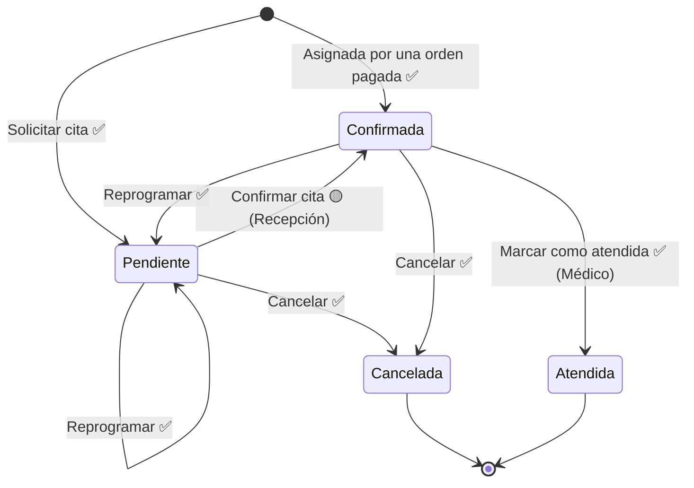

| Estado               | Significado                              | ¿Ocupa el horario?           | ¿Se puede modificar?       |
| -------------------- | ---------------------------------------- | ----------------------------- | --------------------------- |
| **Pendiente**  | Solicitada, a la espera de confirmación | Sí                           | Sí: reprogramar o cancelar |
| **Confirmada** | Aprobada por la clínica                 | Sí                           | Sí: reprogramar o cancelar |
| **Cancelada**  | Anulada por el paciente o la clínica    | **No** (libera el cupo) | No (estado final)           |
| **Atendida**   | El paciente fue atendido                 | Sí (histórico)              | No (estado final)           |

### 5.2 Orden de empresa

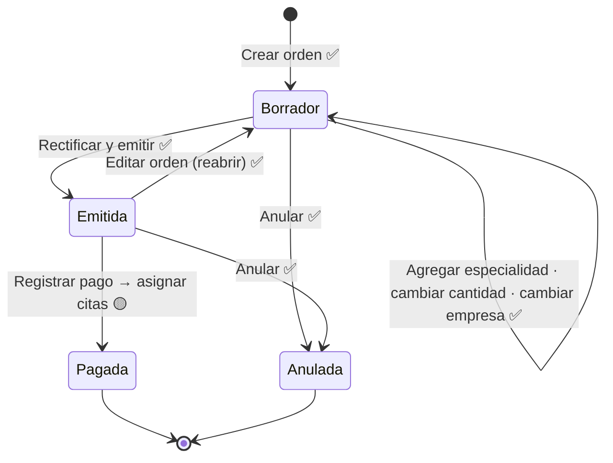

| Estado | Significado | Precios | ¿Se puede modificar? |
| --- | --- | --- | --- |
| **Borrador** | Se arma la orden con la empresa | Se cotiza con el precio vigente | Sí: especialidades, cantidades y empresa |
| **Emitida** | La orden de pago se envió a la empresa | Fijos en cada renglón | Solo reabriéndola (vuelve a borrador) o anulándola |
| **Pagada** | La empresa pagó y las citas están asignadas | Fijos | No: las citas que sobren se cancelan una por una en recepción |
| **Anulada** | Se descartó antes del pago | — | No (estado final) |

---

## 6. Agregados e invariantes

Un **agregado** agrupa entidades que deben cambiar juntas y protege sus
**invariantes** (reglas que nunca se pueden romper).

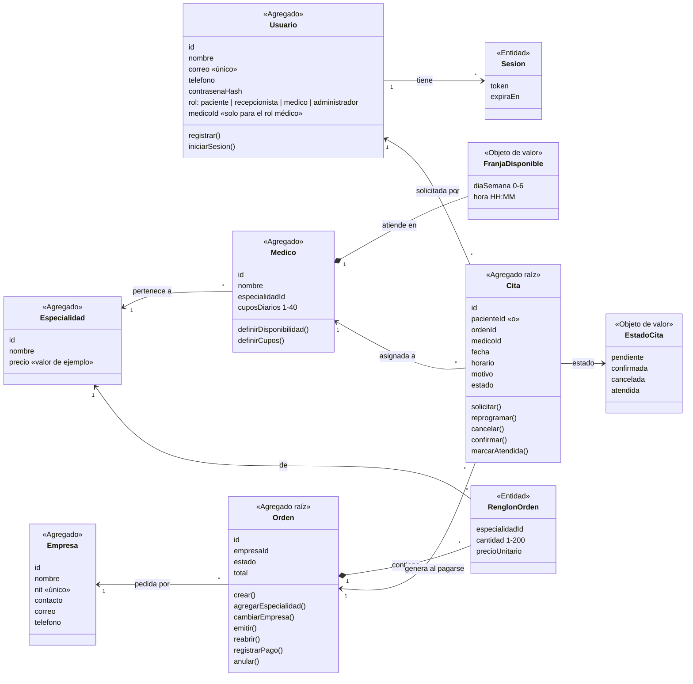

> `confirmar()` y `marcarAtendida()` ya están implementados (primera versión).

| Agregado          | Invariantes (reglas que siempre se cumplen)                                        | Dónde se garantizan                                                                        |
| ----------------- | ---------------------------------------------------------------------------------- | ------------------------------------------------------------------------------------------- |
| **Cita**    | Un médico no puede tener **dos citas activas** en la misma fecha y horario. | Índice único `ux_citas_horario_activo` en la base de datos + validación en el servidor |
|                   | El horario debe estar dentro de la disponibilidad del médico y no en el pasado.   | `validarDatosCita()` en `servidor/rutas/citas.js`                                          |
|                   | Solo las citas **pendientes o confirmadas** se reprograman o cancelan.       | `ESTADOS_MODIFICABLES` en `servidor/rutas/citas.js`                                                     |
|                   | El estado es siempre uno de los cuatro definidos.                                  | `CHECK (estado IN (...))` en la tabla `citas`                                           |
|                   | Un paciente solo ve y modifica **sus** citas.                                | Consultas filtradas por `paciente_id`                                                     |
|                   | Solo se confirman las citas **pendientes** y solo se atienden las **confirmadas**. | Validaciones en `servidor/rutas/personal.js`                                                      |
|                   | Un médico solo atiende las citas de **su** agenda.                                 | Consulta filtrada por `usuarios.medico_id` en `servidor/rutas/personal.js`                        |
|                   | Cada rol solo accede a las rutas de su área.                                       | Middleware `requiereRol` en `servidor/sesion.js` (responde 403)                           |
| **Usuario** | El correo es único.                                                               | `UNIQUE` en `usuarios.correo`                                                           |
|                   | La contraseña nunca se guarda en texto plano.                                     | Hash scrypt con sal aleatoria                                                               |
|                   | El registro público solo crea pacientes: el rol no se acepta desde el cliente.   | `INSERT` de `/api/registro` sin rol (valor por defecto `paciente`)                          |
| **Médico** | Pertenece a una sola especialidad.                                                 | Llave foránea `especialidad_id`                                                          |
|                   | Cada franja (día + hora) aparece una sola vez.                                    | Llave primaria de `disponibilidad`                                                        |
|                   | Nunca tiene en un día más citas activas que sus **cupos diarios** (1 a 40).      | `horariosLibres()` en `servidor/agenda.js` + validación en `PUT /api/admin/medicos/:id/cupos` |
| **Cita** (de una orden) | Una cita es de un paciente **o** de una orden, nunca de ninguno.       | `CHECK (paciente_id IS NOT NULL OR orden_id IS NOT NULL)` en `citas`                     |
| **Empresa** | El NIT es único.                                                                  | `UNIQUE` en `empresas.nit` + validación en `servidor/rutas/ordenes.js`                          |
| **Orden** | Solo en **borrador** se cambian especialidades, cantidades y empresa.             | `exigirEstado()` en `servidor/rutas/ordenes.js` (responde 409)                                      |
|                   | Una especialidad aparece una sola vez por orden; cantidad de 1 a 200.             | Llave primaria `(orden_id, especialidad_id)` + `CHECK` en `orden_items`                   |
|                   | Al emitir, el precio de cada renglón y el total quedan **fijos**.               | `PATCH /api/ordenes/:id/emitir`                                                          |
|                   | Una orden **pagada** no se reabre ni se anula.                                    | `PATCH .../reabrir` y `.../anular` solo aceptan borrador o emitida                       |
|                   | Al pagar se asignan **todas** las citas o **ninguna**.                           | `enTransaccion()` alrededor de `asignarCitas()`                                          |
|                   | Solo recepción y administración gestionan órdenes y empresas.                     | `requiereRol("recepcionista", "administrador")`                                          |

---

## 7. Bounded Contexts y Context Map

Un **Bounded Context** es una frontera donde cada término tiene un único
significado. El sistema se divide en cinco:

| Contexto                                      | Responsabilidad                                    | Términos propios                        | Actores                 | Estado                       |
| --------------------------------------------- | -------------------------------------------------- | ---------------------------------------- | ----------------------- | ---------------------------- |
| 🔐 **Identidad y Acceso**               | Registro, inicio de sesión, sesiones y roles      | Usuario, Sesión, Rol                    | Todos                   | ✅                           |
| 🏥 **Catálogo Clínico**               | Especialidades, médicos y su disponibilidad       | Especialidad, Médico, Franja disponible | Administrador           | ✅ lectura · ✅ gestión básica    |
| 📅 **Agendamiento de Citas** *(Core)* | Solicitar, reprogramar, cancelar y confirmar citas | Cita, Horario disponible, Estado         | Paciente, Recepcionista | ✅ paciente · 🟡 recepción |
| 🩺 **Atención Médica**                | Agenda del médico y registro de la atención      | Agenda, Consulta atendida                | Médico                 | ✅                           |
| 🏢 **Órdenes de Empresas**            | Empresas clientes, cotización, orden de pago y asignación de citas por cupos | Empresa, Orden, Renglón, Cotización, Orden de pago, Cupos | Recepcionista, Administrador (Empresa cliente, externa) | ✅ · 🟡 pago manual |

> En **Órdenes de Empresas** "cita" significa un **cupo vendido** de una
> especialidad (cantidad en un renglón); solo se convierte en una **Cita** de
> Agendamiento, con médico, fecha y hora, cuando se registra el pago.

> **Ejemplo de por qué separar contextos:** "Usuario" en *Identidad y Acceso*
> es quien inicia sesión (correo y contraseña). En *Agendamiento* la misma
> persona es el **Paciente** que solicita una cita: solo importan su id y su
> nombre, no su contraseña.

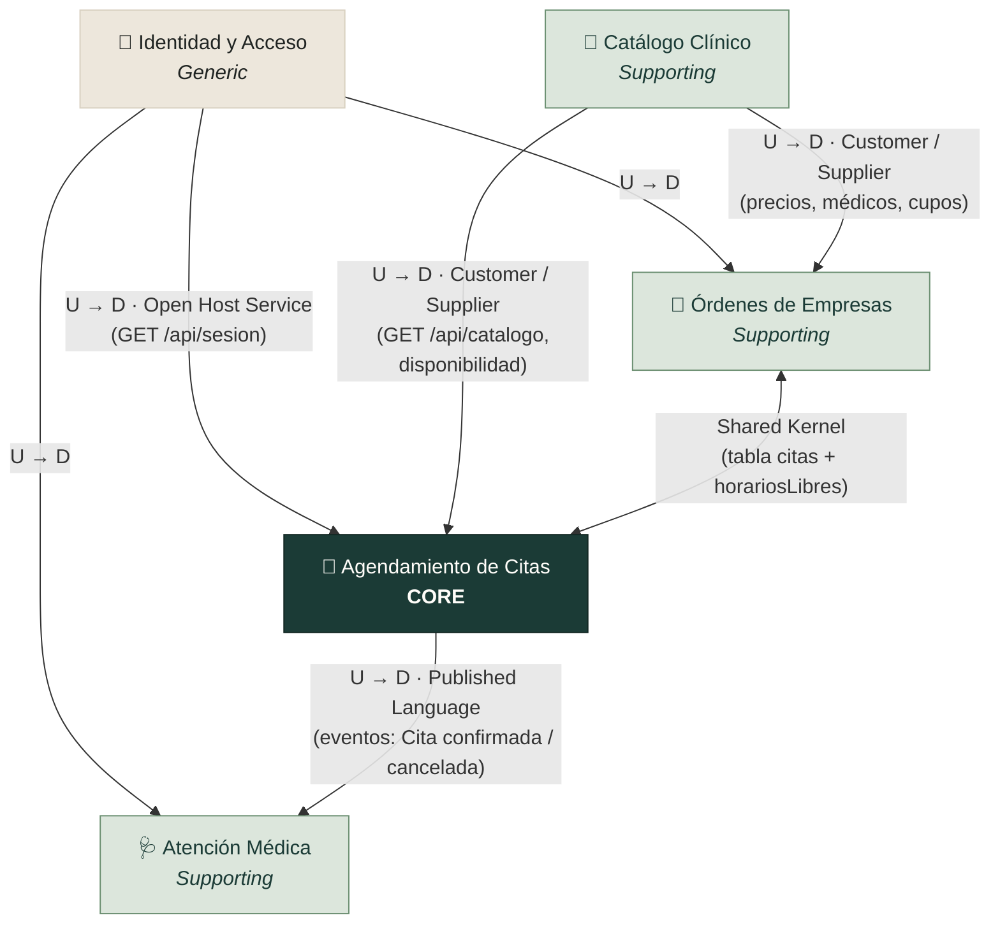

**Cómo leer el mapa** (U = *upstream*, provee · D = *downstream*, consume):

| Relación                         | Tipo                            | Significado                                                                                                           |
| --------------------------------- | ------------------------------- | --------------------------------------------------------------------------------------------------------------------- |
| Identidad → Agendamiento         | **Open Host Service**     | Identidad expone una API estable (`/api/sesion`) que cualquier contexto puede usar para saber quién es el usuario, su rol y el médico vinculado. |
| Catálogo → Agendamiento         | **Customer / Supplier**   | Agendamiento (cliente) necesita médicos y franjas; Catálogo (proveedor) se las entrega según esas necesidades.     |
| Agendamiento → Atención Médica | **Published Language** (objetivo) 🕓 | Atención Médica se enterará de las citas confirmadas o canceladas mediante eventos con un formato acordado.        |
| Catálogo → Órdenes de Empresas | **Customer / Supplier**   | Órdenes necesita el precio de cada especialidad, sus médicos y sus cupos diarios para cotizar y asignar.         |
| Órdenes ↔ Agendamiento          | **Shared Kernel**         | Ambos comparten la tabla `citas` (con su índice único) y la función `horariosLibres()` de `servidor/agenda.js`. Así una cita de empresa y una de paciente nunca chocan ni superan los cupos. Cambiar ese núcleo exige acuerdo entre los dos contextos. |

> **Estado actual:** hoy no se publican eventos. Atención Médica consulta directamente
> la tabla `citas` (`GET /api/medico/agenda`). La relación *Published Language* sigue
> siendo el objetivo de diseño si los contextos llegan a separarse.

---

## 8. Lenguaje ubicuo (glosario)

Términos que **todo el equipo** (desarrollo, clínica, docentes) usa con el
mismo significado, en las conversaciones, en la interfaz y en el código.

| Término                          | Definición                                                              | En el código                                             |
| --------------------------------- | ------------------------------------------------------------------------ | --------------------------------------------------------- |
| **Paciente**                | Persona registrada que solicita citas.                                   | `usuarios` con `rol = 'paciente'`                     |
| **Especialidad**            | Área médica (los nombres reales están pendientes de confirmar).       | `especialidades`                                        |
| **Médico**                 | Profesional que atiende una especialidad.                                | `medicos`                                               |
| **Médico (cuenta)**         | Usuario con rol médico, vinculado a un médico del catálogo.              | `usuarios.medico_id`                                      |
| **Disponibilidad / Franja** | Día de la semana y hora en que un médico atiende.                      | `disponibilidad`                                        |
| **Horario disponible**      | Franja del médico en una fecha concreta que **no** está ocupada. | `horariosLibres()` · `GET /api/horarios-disponibles` |
| **Cita**                    | Reserva de un paciente con un médico en una fecha y horario.            | `citas`                                                 |
| **Cita activa**             | Cita que ocupa su horario (todo estado excepto *cancelada*).           | `WHERE estado <> 'cancelada'`                           |
| **Solicitar**               | Crear una cita nueva (queda pendiente).                                  | `POST /api/citas`                                       |
| **Reprogramar**             | Cambiar médico, fecha u horario de una cita; vuelve a pendiente.        | `PUT /api/citas/:id`                                    |
| **Cancelar**                | Anular una cita; libera su horario.                                      | `PATCH /api/citas/:id/cancelar` (paciente) · `PATCH /api/recepcion/citas/:id/cancelar` (recepción)                         |
| **Confirmar**               | La clínica aprueba la cita. 🟡                                          | `PATCH /api/recepcion/citas/:id/confirmar` |
| **Atendida**                | La consulta se realizó. ✅                                              | `PATCH /api/medico/citas/:id/atender` |
| **Motivo**                  | Descripción opcional de la consulta (máx. 300 caracteres).             | `citas.motivo`                                          |
| **Sesión**                 | Acceso autenticado de un usuario, dura 8 horas.                          | `sesiones` · cookie `altavida_sesion`                |
| **Cupos diarios**          | Máximo de pacientes que un médico atiende en un día (1 a 40; 4 por defecto). | `medicos.cupos_diarios` · `PUT /api/admin/medicos/:id/cupos` |
| **Especialidad agendable** | Especialidad con al menos un médico que tiene horario; solo esas se ofrecen para agendar. | `especialidadesAgendables()` en `comun.js`      |
| **Agenda pública**         | Horas de un médico en un día, marcadas libres u ocupadas, sin datos de pacientes. | `GET /api/agenda-publica` · portada            |
| **Preselección**           | Hora elegida en la portada que se guarda mientras el visitante ingresa; no reserva nada. | `guardarPreseleccion()` (`sessionStorage`) |
| **Empresa cliente**        | Empresa que compra citas para sus empleados.                            | `empresas` · `/api/empresas`                            |
| **NIT**                    | Número de identificación tributaria de la empresa; único.               | `empresas.nit`                                          |
| **Orden**                  | Pedido de citas de una empresa, por especialidad y cantidad.            | `ordenes` · `/api/ordenes`                              |
| **Renglón**                | Una especialidad dentro de la orden, con su cantidad y su precio.       | `orden_items`                                           |
| **Cotización**             | Total de la orden calculado con los precios de ejemplo vigentes (en borrador). | `obtenerOrden()` en `servidor/rutas/ordenes.js`        |
| **Rectificar y emitir**    | Revisar la orden y emitir la orden de pago; fija precios y total.       | `PATCH /api/ordenes/:id/emitir`                         |
| **Orden de pago**          | Documento que se envía a la empresa con el detalle y el total a pagar.  | `html/recepcion/orden-pago.html`                        |
| **Editar orden (reabrir)** | Devolver una orden emitida a borrador para corregirla.                  | `PATCH /api/ordenes/:id/reabrir`                        |
| **Registrar pago**         | Indicar que la empresa pagó; dispara la asignación de citas.            | `PATCH /api/ordenes/:id/pagar`                          |
| **Asignación por cupos**   | Reparto automático de las citas de una orden entre médicos y días.      | `asignarCitasDeOrden()` en `servidor/asignacion.js`               |
| **Por cobrar**             | Suma de las órdenes emitidas que la empresa aún no paga.                | `GET /api/admin/resumen`                                |
| **Ocupación**              | Citas activas frente a cupos de un médico en los próximos 7 días.       | `GET /api/admin/resumen` · `html/admin/panel.html`      |

---

## 9. Hotspots: preguntas abiertas 🟥

Dudas que surgieron al modelar y que **la clínica debe responder** antes de
las siguientes etapas. No se inventaron reglas para ellas.

| #  | Pregunta                                                           | Afecta a   | Por qué importa                           |
| -- | ------------------------------------------------------------------ | ---------- | ------------------------------------------ |
| H1 | ¿Se piden tipo y número de documento al registrarse?             | Identidad  | Ya figura como pendiente en el README.     |
| H2 | ¿Cuántas citas activas puede tener un paciente a la vez?         | Cita       | Evita que una persona acapare horarios.    |
| H3 | ¿Hasta cuántas horas antes se puede cancelar o reprogramar?      | Cita       | Hoy se permite en cualquier momento.       |
| H4 | ¿Quién confirma la cita y en cuánto tiempo? ¿Se confirma sola? | Recepción | Define el flujo de la etapa de recepción. |
| H5 | ¿Cómo se avisa al paciente (correo, SMS, solo en la app)?        | Políticas | Requiere integrar un servicio externo.     |
| H6 | ¿Existe el estado "no asistió"?                                  | Cita       | Hoy solo hay cuatro estados definidos.     |
| H7 | ¿Cuánto dura cada cita? ¿Varía según la especialidad?         | Catálogo  | Hoy cada franja es un horario fijo.        |
| H8 | ¿Un médico puede atender varias especialidades?                  | Catálogo  | Hoy pertenece a una sola.                  |
| H9 | ¿Se manejan festivos o ausencias del médico?                     | Catálogo  | Hoy solo cuenta el día de la semana.      |
| H10 | ¿Cómo se crean las cuentas del personal y quién las administra?    | Identidad  | Hoy son cuentas de demostración con contraseña compartida. |
| H11 | ¿Se pueden editar o desactivar especialidades y médicos ya creados? | Catálogo  | Hoy el administrador solo crea y define horarios; no se borra nada. |
| H12 | ¿El pago de la empresa es real (pasarela, transferencia con comprobante) o solo se registra a mano? | Órdenes | Hoy recepción marca "pagada" sin comprobante. |
| H13 | ¿Se registran los nombres de los empleados que asisten a cada cita? | Órdenes / Cita | Hoy la cita figura a nombre de la empresa. |
| H14 | ¿Cuáles son los precios reales y quién los define o actualiza? | Catálogo / Órdenes | Hoy son valores de ejemplo fijos, sin pantalla para editarlos. |
| H15 | ¿La orden de pago y las fechas asignadas se envían solas a la empresa? | Órdenes / Políticas | Hoy se imprime o guarda en PDF y se envía a mano. |
| H16 | ¿Qué pasa si hay que corregir una orden ya pagada (más citas, otra especialidad)? | Órdenes | Hoy no se edita: se cancelan citas en recepción o se crea otra orden. |
| H17 | ¿La empresa puede pedir días u horarios preferidos? | Órdenes | Hoy se asigna desde mañana, en la primera hora libre. |
| H18 | ¿Los cupos cambian según el día o son iguales toda la semana? | Catálogo | Hoy un mismo número para todos los días del médico. |

> **Decisiones provisionales ya implementadas** (por confirmar con la clínica):
> **H2** sin límite de citas activas por paciente; **H3** sin plazo mínimo para
> cancelar o reprogramar; **H4** confirmación manual por la recepcionista, sin plazo.
> Si la respuesta cambia, hay que ajustar `validarDatosCita()` (`servidor/rutas/citas.js`) y `servidor/rutas/personal.js`.
> En órdenes: **H12** pago registrado a mano; **H14** precios de ejemplo (60.000,
> 85.000, 95.000 y 120.000; 80.000 para especialidades nuevas); **H16** una orden
> pagada no se edita; **H17** asignación desde mañana y hasta 120 días; **H18** 4
> cupos por día por defecto. Se ajustan en `servidor/asignacion.js`, `servidor/rutas/ordenes.js` y `servidor/bd/valores.js`.

---

## 10. Del modelo al código

Cómo se refleja cada concepto del dominio en la implementación actual:

| Concepto DDD                    | Contexto           | Base de datos                                       | API (`servidor/rutas/`)                                      | Interfaz (Vue)                                                     |
| ------------------------------- | ------------------ | --------------------------------------------------- | ------------------------------------------------------------------- | ------------------------------------------------------------------ |
| Usuario / Sesión               | Identidad y Acceso | `usuarios`, `sesiones`                          | `/api/registro`, `/api/login`, `/api/logout`, `/api/sesion` | `html/registro.html`, `html/login.html`                        |
| Especialidad / Médico / Franja | Catálogo Clínico | `especialidades`, `medicos`, `disponibilidad` | `/api/catalogo`                                                   | selects de `solicitud-cita.html`                                 |
| Horario disponible (lectura)    | Agendamiento       | consulta sobre `disponibilidad` y `citas`       | `/api/horarios-disponibles`                                       | botones de horario                                                 |
| Cita (agregado raíz)           | Agendamiento       | `citas` + índice `ux_citas_horario_activo`     | `/api/citas` (GET, POST, PUT, PATCH)                              | `solicitud-cita.html`, `confirmacion.html`, `mis-citas.html` |
| Estado de la cita               | Agendamiento       | `CHECK` en `citas.estado`                       | `ESTADOS_MODIFICABLES`                                            | `<etiqueta-estado>`                                              |
| Recepción de citas              | Agendamiento       | `citas`                                             | `/api/recepcion/citas` (GET, PATCH confirmar y cancelar)           | `html/recepcion/citas.html`                                        |
| Agenda y atención               | Atención Médica    | `citas`, `usuarios.medico_id`                       | `/api/medico/agenda`, `/api/medico/citas/:id/atender`              | `html/medico/agenda.html`                                          |
| Gestión del catálogo            | Catálogo Clínico | `especialidades`, `medicos`, `disponibilidad`       | `/api/admin/catalogo`, `/api/admin/especialidades`, `/api/admin/medicos` | `html/admin/catalogo.html`                                   |
| Cupos diarios                   | Catálogo Clínico | `medicos.cupos_diarios`                              | `PUT /api/admin/medicos/:id/cupos` · usado por `horariosLibres()`  | columna "Cupos por día" en `html/admin/catalogo.html`             |
| Agenda pública (lectura)        | Agendamiento     | consulta sobre `disponibilidad` y `citas`            | `GET /api/agenda-publica`                                          | carné de `index.html` (`assets/js/vue/inicio.js`)                  |
| Empresa                         | Órdenes de Empresas | `empresas`                                        | `/api/empresas` (GET, POST, PUT) · `servidor/rutas/ordenes.js`           | `html/admin/empresas.html`                                         |
| Orden y renglones (agregado raíz) | Órdenes de Empresas | `ordenes`, `orden_items`                       | `/api/ordenes` (GET, POST, PUT items y empresa, PATCH emitir, reabrir, pagar, anular) | `html/recepcion/ordenes.html`                   |
| Orden de pago (lectura)         | Órdenes de Empresas | `ordenes`, `orden_items`, `empresas`              | `GET /api/ordenes/:id`                                             | `html/recepcion/orden-pago.html`                                   |
| Asignación por cupos (política) | Órdenes ↔ Agendamiento | `citas.orden_id` + `ux_citas_horario_activo`   | `asignarCitas()` dentro de `PATCH /api/ordenes/:id/pagar`          | lista "Citas asignadas" de la orden                                |
| Panel (lectura)                 | Administración (lee todos) | consultas sobre `citas`, `medicos`, `disponibilidad`, `ordenes` | `GET /api/admin/resumen`                  | `html/admin/panel.html`                                            |

### Próximos pasos sugeridos

1. Resolver con la clínica los **hotspots** H2 a H4 (hoy con reglas provisionales) y confirmar H10 y H11.
2. Definir cómo se crean las cuentas del personal y reemplazar las contraseñas de demostración.
3. Implementar la **notificación** al paciente cuando se confirma una cita (H5) y el envío automático de la orden de pago a la empresa (H15).
4. Definir precios reales y quién los administra (H14), y cómo se registra un pago real (H12).
5. Completar la gestión del Catálogo (editar o desactivar especialidades y médicos) y paginar el listado de recepción.
6. Agregar pruebas automáticas para las reglas de las citas, los cupos, la asignación de órdenes y los roles.

---

*Documentos relacionados:* [README](../README.md) · [Uso de Vue.js](VUE.md)
