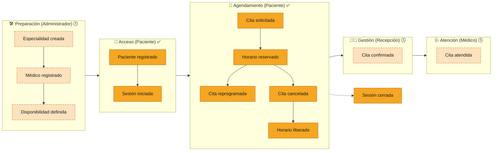
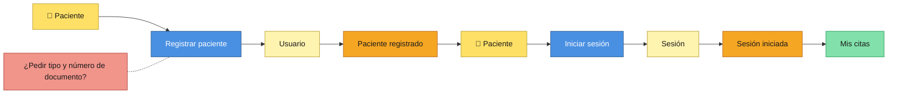
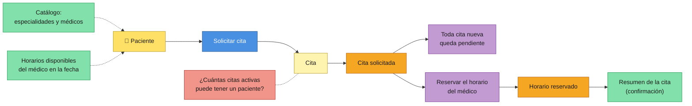
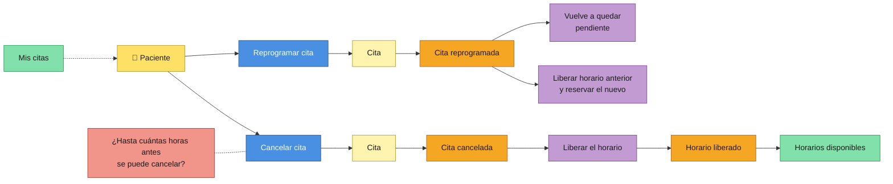
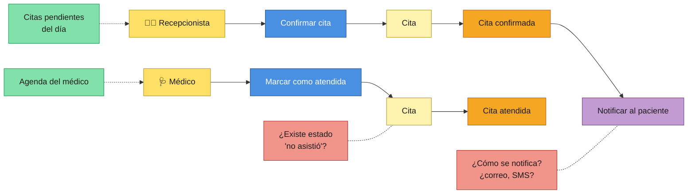
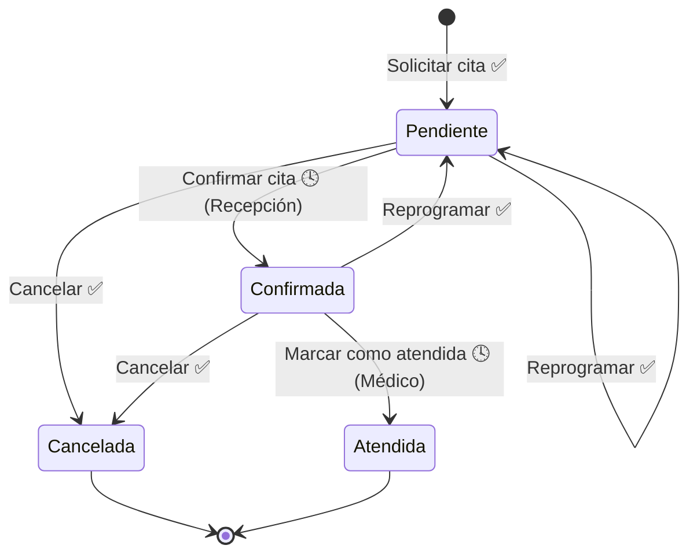
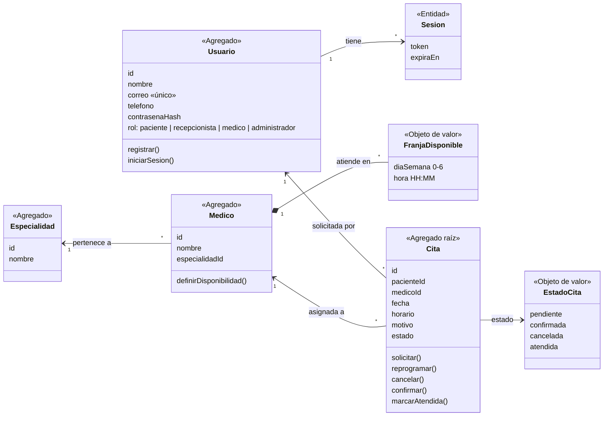
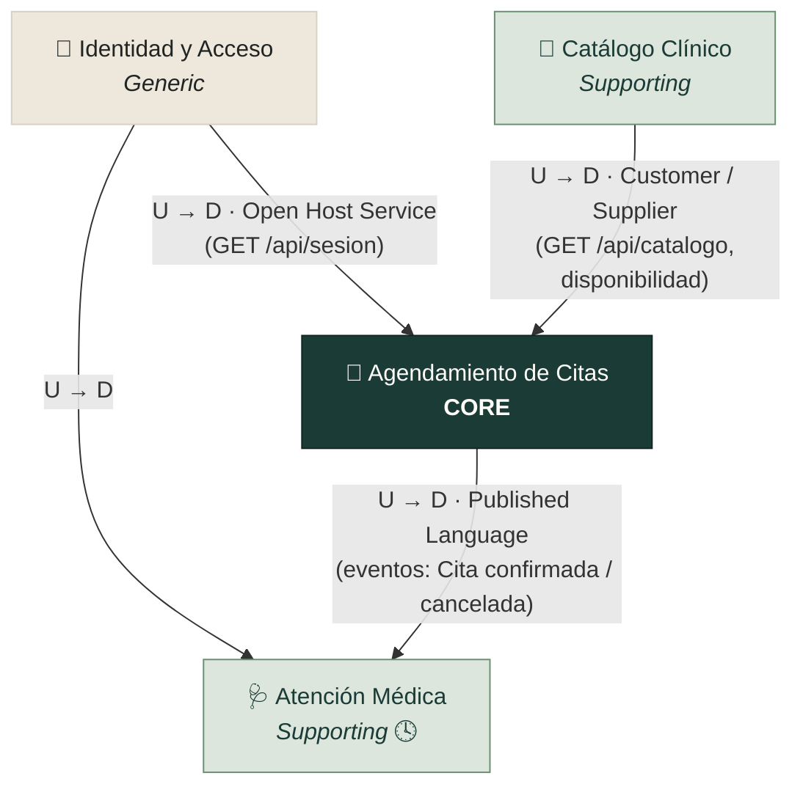

# Clínica Altavida — Contextualización con DDD y Event Storming

Este documento describe el **dominio** del sistema de gestión de citas de
Clínica Altavida usando **Domain-Driven Design (DDD)** y la técnica de
**Event Storming**. Muestra qué ocurre en el negocio, quién lo provoca, qué
reglas se cumplen y cómo se divide el sistema en contextos.

**Contenido**

1. [Visión del dominio](#1-visión-del-dominio)
2. [Leyenda del Event Storming](#2-leyenda-del-event-storming)
3. [Big Picture: línea de tiempo de eventos](#3-big-picture-línea-de-tiempo-de-eventos)
4. [Process Level: cada flujo en detalle](#4-process-level-cada-flujo-en-detalle)
5. [Ciclo de vida de una Cita](#5-ciclo-de-vida-de-una-cita)
6. [Agregados e invariantes](#6-agregados-e-invariantes)
7. [Bounded Contexts y Context Map](#7-bounded-contexts-y-context-map)
8. [Lenguaje ubicuo (glosario)](#8-lenguaje-ubicuo-glosario)
9. [Hotspots: preguntas abiertas](#9-hotspots-preguntas-abiertas)
10. [Del modelo al código](#10-del-modelo-al-código)

> **Estado del alcance.** Las etapas 1 a 3 implementan el flujo del
> **paciente**. Los flujos de **recepción**, **médico** y **administración**
> se modelan aquí como **pendientes** (etapas posteriores) para que el diseño
> futuro ya tenga un marco. En las tablas se marcan así:
> ✅ implementado · 🕓 pendiente.

---

## 1. Visión del dominio

**Problema:** coordinar las citas médicas de varias especialidades sin
llamadas ni mensajes cruzados, evitando que dos pacientes ocupen el mismo
horario de un médico.

**Dominio principal (Core Domain):** el **Agendamiento de Citas**: reservar,
reprogramar y cancelar citas respetando la disponibilidad real de cada
médico. Es lo que diferencia al sistema y donde están las reglas más
importantes.

| Tipo de subdominio             | Subdominio            | Por qué                                                                               |
| ------------------------------ | --------------------- | -------------------------------------------------------------------------------------- |
| **Core** (principal)     | Agendamiento de Citas | Es el valor del sistema: disponibilidad real y cero dobles reservas.                   |
| **Supporting** (soporte) | Catálogo Clínico    | Especialidades, médicos y horarios de atención; necesarios, pero no diferenciadores. |
| **Supporting** (soporte) | Atención Médica     | Agenda del día del médico y registro de citas atendidas.                             |
| **Generic** (genérico)  | Identidad y Acceso    | Registro, inicio de sesión y roles: es igual en cualquier sistema.                    |

### Actores

| Actor                          | Rol en el dominio                                                     | Estado |
| ------------------------------ | --------------------------------------------------------------------- | ------ |
| 🧑 **Paciente**          | Se registra, solicita, reprograma y cancela sus citas.                | ✅     |
| 🧑‍💼 **Recepcionista** | Gestiona las citas: las confirma o cancela.                           | 🕓     |
| 🩺 **Médico**           | Consulta su agenda y marca las citas como atendidas.                  | 🕓     |
| 🛠️ **Administrador**   | Gestiona especialidades, médicos y horarios.                         | 🕓     |
| ⚙️ **Sistema**         | Aplica las políticas automáticas (liberar horarios, validar cupos). | ✅     |

---

## 2. Leyenda del Event Storming

Event Storming usa notas adhesivas de colores. En los diagramas de este
documento se respetan los colores clásicos:

| Color       | Elemento                             | Qué representa                                               | Cómo se escribe                       |
| ----------- | ------------------------------------ | ------------------------------------------------------------- | -------------------------------------- |
| 🟧 Naranja  | **Evento de dominio**          | Algo importante que **ya ocurrió**                     | En pasado: *Cita solicitada*         |
| 🟦 Azul     | **Comando**                    | Una intención o acción que provoca un evento                | En infinitivo: *Solicitar cita*      |
| 🟨 Amarillo | **Actor** / **Agregado** | Quién ejecuta el comando / la entidad que protege las reglas | *Paciente* / *Cita*                |
| 🟪 Lila     | **Política**                  | Regla automática: "cuando ocurre X, entonces Y"              | *Cuando se cancela, liberar horario* |
| 🟩 Verde    | **Modelo de lectura**          | La información que el actor ve para decidir                  | *Horarios disponibles*               |
| 🟥 Rosa     | **Hotspot**                    | Duda, riesgo o regla aún sin definir                         | *¿Plazo para cancelar?*             |

```mermaid
flowchart LR
    A["🟨 Actor"]:::actor --> C["🟦 Comando"]:::comando --> G["🟨 Agregado"]:::agregado --> E["🟧 Evento"]:::evento
    E --> P["🟪 Política"]:::politica --> C2["🟦 Comando siguiente"]:::comando
    R["🟩 Modelo de lectura"]:::lectura -. informa .-> A

    classDef evento fill:#F5A623,stroke:#B5651D,color:#1A1A1A
    classDef comando fill:#4A90E2,stroke:#2C5A8C,color:#FFFFFF
    classDef actor fill:#FFE066,stroke:#B39A2B,color:#1A1A1A
    classDef agregado fill:#FFF3B0,stroke:#B39A2B,color:#1A1A1A
    classDef politica fill:#C39BD3,stroke:#7D3C98,color:#1A1A1A
    classDef lectura fill:#82E0AA,stroke:#239B56,color:#1A1A1A
```

---

## 3. Big Picture: línea de tiempo de eventos

Primer paso del Event Storming: **todos los eventos del dominio, en orden
cronológico**, de izquierda a derecha.

> Los eventos con borde punteado y color claro pertenecen a etapas
> posteriores (🕓). Hoy el catálogo de especialidades, médicos y horarios se
> carga como **datos de demostración** al crear la base de datos.

### Catálogo de eventos de dominio

| #  | Evento 🟧                         | Lo provoca                        | Datos que lleva                           | Estado |
| -- | --------------------------------- | --------------------------------- | ----------------------------------------- | ------ |
| 1  | **Especialidad creada**     | Administrador                     | id, nombre                                | 🕓     |
| 2  | **Médico registrado**      | Administrador                     | id, nombre, especialidad                  | 🕓     |
| 3  | **Disponibilidad definida** | Administrador                     | médico, día de la semana, horas         | 🕓     |
| 4  | **Paciente registrado**     | Paciente                          | nombre, correo, teléfono                 | ✅     |
| 5  | **Sesión iniciada**        | Paciente                          | usuario, vencimiento (8 h)                | ✅     |
| 6  | **Cita solicitada**         | Paciente                          | paciente, médico, fecha, horario, motivo | ✅     |
| 7  | **Horario reservado**       | Sistema (política)               | médico, fecha, horario                   | ✅     |
| 8  | **Cita reprogramada**       | Paciente                          | cita, nuevo médico/fecha/horario         | ✅     |
| 9  | **Cita cancelada**          | Paciente (🕓 también Recepción) | cita                                      | ✅     |
| 10 | **Horario liberado**        | Sistema (política)               | médico, fecha, horario                   | ✅     |
| 11 | **Cita confirmada**         | Recepcionista                     | cita                                      | 🕓     |
| 12 | **Cita atendida**           | Médico                           | cita                                      | 🕓     |
| 13 | **Sesión cerrada**         | Paciente                          | usuario                                   | ✅     |

---

## 4. Process Level: cada flujo en detalle

Segundo paso: para cada flujo se agrega **quién** actúa, **qué comando**
ejecuta, **qué ve** para decidir, **qué agregado** valida las reglas y **qué
políticas** se disparan.

### 4.1 Registro e inicio de sesión ✅

| Comando 🟦         | Reglas que se validan                                                                                                  | Evento 🟧 si tiene éxito | Si falla                               |
| ------------------ | ---------------------------------------------------------------------------------------------------------------------- | ------------------------- | -------------------------------------- |
| Registrar paciente | Nombre ≥ 3 letras · correo válido y **único** · teléfono de 7 a 15 dígitos · contraseña ≥ 8 caracteres | Paciente registrado       | "Ya existe una cuenta con este correo" |
| Iniciar sesión    | Correo y contraseña coinciden (hash scrypt)                                                                           | Sesión iniciada          | "Correo o contraseña incorrectos"     |
| Cerrar sesión     | —                                                                                                                     | Sesión cerrada           | —                                     |

### 4.2 Solicitar una cita ✅ (flujo principal)

**Reglas del comando *Solicitar cita*:**

1. El médico pertenece a la especialidad elegida.
2. La fecha no está en el pasado.
3. El médico atiende ese **día de la semana**.
4. El horario está dentro de la disponibilidad del médico, **no está ocupado**
   por otra cita activa y, si la fecha es hoy, no ya pasó.
5. El motivo es opcional (máximo 300 caracteres).

### 4.3 Reprogramar y cancelar ✅

Solo se pueden reprogramar o cancelar las citas en estado **pendiente** o
**confirmada**, y únicamente por el paciente dueño de la cita.

### 4.4 Gestión de recepción y atención médica 🕓

### Resumen de comandos

| Comando 🟦             | Actor                    | Agregado     | Evento 🟧                            | Estado  |
| ---------------------- | ------------------------ | ------------ | ------------------------------------ | ------- |
| Registrar paciente     | Paciente                 | Usuario      | Paciente registrado                  | ✅      |
| Iniciar sesión        | Paciente                 | Sesión      | Sesión iniciada                     | ✅      |
| Cerrar sesión         | Paciente                 | Sesión      | Sesión cerrada                      | ✅      |
| Solicitar cita         | Paciente                 | Cita         | Cita solicitada → Horario reservado | ✅      |
| Reprogramar cita       | Paciente                 | Cita         | Cita reprogramada                    | ✅      |
| Cancelar cita          | Paciente / Recepcionista | Cita         | Cita cancelada → Horario liberado   | ✅ / 🕓 |
| Confirmar cita         | Recepcionista            | Cita         | Cita confirmada                      | 🕓      |
| Marcar como atendida   | Médico                  | Cita         | Cita atendida                        | 🕓      |
| Crear especialidad     | Administrador            | Especialidad | Especialidad creada                  | 🕓      |
| Registrar médico      | Administrador            | Médico      | Médico registrado                   | 🕓      |
| Definir disponibilidad | Administrador            | Médico      | Disponibilidad definida              | 🕓      |

### Políticas 🟪

| Política              | Cuando…                          | Entonces…                                                  | Estado |
| ---------------------- | --------------------------------- | ----------------------------------------------------------- | ------ |
| Cita nueva pendiente   | se solicita una cita              | queda en estado **pendiente**                         | ✅     |
| Reserva de horario     | se solicita o reprograma una cita | el horario queda **ocupado** para ese médico y fecha | ✅     |
| Reprogramar reinicia   | se reprograma una cita            | vuelve a **pendiente** (requiere nueva confirmación) | ✅     |
| Liberación de horario | se cancela una cita               | el horario vuelve a estar **disponible**              | ✅     |
| Notificación          | se confirma una cita              | se avisa al paciente                                        | 🕓     |

### Modelos de lectura 🟩

| Modelo de lectura                                            | Lo usa        | Para decidir…                     | Estado |
| ------------------------------------------------------------ | ------------- | ---------------------------------- | ------ |
| Catálogo (especialidades y médicos con días de atención) | Paciente      | qué especialidad y médico elegir | ✅     |
| Horarios disponibles                                         | Paciente      | qué horario reservar              | ✅     |
| Resumen de la cita                                           | Paciente      | verificar lo que solicitó         | ✅     |
| Mis citas (con filtro por estado)                            | Paciente      | qué cita reprogramar o cancelar   | ✅     |
| Citas pendientes del día                                    | Recepcionista | qué citas confirmar               | 🕓     |
| Agenda del médico                                           | Médico       | a quién atender                   | 🕓     |

---

## 5. Ciclo de vida de una Cita

La **Cita** es el agregado central del dominio. Solo puede estar en uno de
estos cuatro estados:

| Estado               | Significado                              | ¿Ocupa el horario?           | ¿Se puede modificar?       |
| -------------------- | ---------------------------------------- | ----------------------------- | --------------------------- |
| **Pendiente**  | Solicitada, a la espera de confirmación | Sí                           | Sí: reprogramar o cancelar |
| **Confirmada** | Aprobada por la clínica                 | Sí                           | Sí: reprogramar o cancelar |
| **Cancelada**  | Anulada por el paciente o la clínica    | **No** (libera el cupo) | No (estado final)           |
| **Atendida**   | El paciente fue atendido                 | Sí (histórico)              | No (estado final)           |

---

## 6. Agregados e invariantes

Un **agregado** agrupa entidades que deben cambiar juntas y protege sus
**invariantes** (reglas que nunca se pueden romper).

> `confirmar()` y `marcarAtendida()` corresponden a etapas posteriores 🕓.

| Agregado          | Invariantes (reglas que siempre se cumplen)                                        | Dónde se garantizan                                                                        |
| ----------------- | ---------------------------------------------------------------------------------- | ------------------------------------------------------------------------------------------- |
| **Cita**    | Un médico no puede tener **dos citas activas** en la misma fecha y horario. | Índice único `ux_citas_horario_activo` en la base de datos + validación en el servidor |
|                   | El horario debe estar dentro de la disponibilidad del médico y no en el pasado.   | `validarDatosCita()` en `servidor/servidor.js`                                          |
|                   | Solo las citas **pendientes o confirmadas** se reprograman o cancelan.       | `ESTADOS_MODIFICABLES` en el servidor                                                     |
|                   | El estado es siempre uno de los cuatro definidos.                                  | `CHECK (estado IN (...))` en la tabla `citas`                                           |
|                   | Un paciente solo ve y modifica **sus** citas.                                | Consultas filtradas por `paciente_id`                                                     |
| **Usuario** | El correo es único.                                                               | `UNIQUE` en `usuarios.correo`                                                           |
|                   | La contraseña nunca se guarda en texto plano.                                     | Hash scrypt con sal aleatoria                                                               |
| **Médico** | Pertenece a una sola especialidad.                                                 | Llave foránea `especialidad_id`                                                          |
|                   | Cada franja (día + hora) aparece una sola vez.                                    | Llave primaria de `disponibilidad`                                                        |

---

## 7. Bounded Contexts y Context Map

Un **Bounded Context** es una frontera donde cada término tiene un único
significado. El sistema se divide en cuatro:

| Contexto                                      | Responsabilidad                                    | Términos propios                        | Actores                 | Estado                       |
| --------------------------------------------- | -------------------------------------------------- | ---------------------------------------- | ----------------------- | ---------------------------- |
| 🔐 **Identidad y Acceso**               | Registro, inicio de sesión, sesiones y roles      | Usuario, Sesión, Rol                    | Todos                   | ✅                           |
| 🏥 **Catálogo Clínico**               | Especialidades, médicos y su disponibilidad       | Especialidad, Médico, Franja disponible | Administrador           | ✅ lectura · 🕓 gestión    |
| 📅 **Agendamiento de Citas** *(Core)* | Solicitar, reprogramar, cancelar y confirmar citas | Cita, Horario disponible, Estado         | Paciente, Recepcionista | ✅ paciente · 🕓 recepción |
| 🩺 **Atención Médica**                | Agenda del médico y registro de la atención      | Agenda, Consulta atendida                | Médico                 | 🕓                           |

> **Ejemplo de por qué separar contextos:** "Usuario" en *Identidad y Acceso*
> es quien inicia sesión (correo y contraseña). En *Agendamiento* la misma
> persona es el **Paciente** que solicita una cita: solo importan su id y su
> nombre, no su contraseña.

**Cómo leer el mapa** (U = *upstream*, provee · D = *downstream*, consume):

| Relación                         | Tipo                            | Significado                                                                                                           |
| --------------------------------- | ------------------------------- | --------------------------------------------------------------------------------------------------------------------- |
| Identidad → Agendamiento         | **Open Host Service**     | Identidad expone una API estable (`/api/sesion`) que cualquier contexto puede usar para saber quién es el usuario. |
| Catálogo → Agendamiento         | **Customer / Supplier**   | Agendamiento (cliente) necesita médicos y franjas; Catálogo (proveedor) se las entrega según esas necesidades.     |
| Agendamiento → Atención Médica | **Published Language** 🕓 | Atención Médica se enterará de las citas confirmadas o canceladas mediante eventos con un formato acordado.        |

---

## 8. Lenguaje ubicuo (glosario)

Términos que **todo el equipo** (desarrollo, clínica, docentes) usa con el
mismo significado, en las conversaciones, en la interfaz y en el código.

| Término                          | Definición                                                              | En el código                                             |
| --------------------------------- | ------------------------------------------------------------------------ | --------------------------------------------------------- |
| **Paciente**                | Persona registrada que solicita citas.                                   | `usuarios` con `rol = 'paciente'`                     |
| **Especialidad**            | Área médica (los nombres reales están pendientes de confirmar).       | `especialidades`                                        |
| **Médico**                 | Profesional que atiende una especialidad.                                | `medicos`                                               |
| **Disponibilidad / Franja** | Día de la semana y hora en que un médico atiende.                      | `disponibilidad`                                        |
| **Horario disponible**      | Franja del médico en una fecha concreta que **no** está ocupada. | `horariosLibres()` · `GET /api/horarios-disponibles` |
| **Cita**                    | Reserva de un paciente con un médico en una fecha y horario.            | `citas`                                                 |
| **Cita activa**             | Cita que ocupa su horario (todo estado excepto *cancelada*).           | `WHERE estado <> 'cancelada'`                           |
| **Solicitar**               | Crear una cita nueva (queda pendiente).                                  | `POST /api/citas`                                       |
| **Reprogramar**             | Cambiar médico, fecha u horario de una cita; vuelve a pendiente.        | `PUT /api/citas/:id`                                    |
| **Cancelar**                | Anular una cita; libera su horario.                                      | `PATCH /api/citas/:id/cancelar`                         |
| **Confirmar**               | La clínica aprueba la cita. 🕓                                          | —                                                        |
| **Atendida**                | La consulta se realizó. 🕓                                              | —                                                        |
| **Motivo**                  | Descripción opcional de la consulta (máx. 300 caracteres).             | `citas.motivo`                                          |
| **Sesión**                 | Acceso autenticado de un usuario, dura 8 horas.                          | `sesiones` · cookie `altavida_sesion`                |

---

## 9. Hotspots: preguntas abiertas 🟥

Dudas que surgieron al modelar y que **la clínica debe responder** antes de
las siguientes etapas. No se inventaron reglas para ellas.

| #  | Pregunta                                                           | Afecta a   | Por qué importa                           |
| -- | ------------------------------------------------------------------ | ---------- | ------------------------------------------ |
| H1 | ¿Se piden tipo y número de documento al registrarse?             | Identidad  | Ya figura como pendiente en el README.     |
| H2 | ¿Cuántas citas activas puede tener un paciente a la vez?         | Cita       | Evita que una persona acapare horarios.    |
| H3 | ¿Hasta cuántas horas antes se puede cancelar o reprogramar?      | Cita       | Hoy se permite en cualquier momento.       |
| H4 | ¿Quién confirma la cita y en cuánto tiempo? ¿Se confirma sola? | Recepción | Define el flujo de la etapa de recepción. |
| H5 | ¿Cómo se avisa al paciente (correo, SMS, solo en la app)?        | Políticas | Requiere integrar un servicio externo.     |
| H6 | ¿Existe el estado "no asistió"?                                  | Cita       | Hoy solo hay cuatro estados definidos.     |
| H7 | ¿Cuánto dura cada cita? ¿Varía según la especialidad?         | Catálogo  | Hoy cada franja es un horario fijo.        |
| H8 | ¿Un médico puede atender varias especialidades?                  | Catálogo  | Hoy pertenece a una sola.                  |
| H9 | ¿Se manejan festivos o ausencias del médico?                     | Catálogo  | Hoy solo cuenta el día de la semana.      |

---

## 10. Del modelo al código

Cómo se refleja cada concepto del dominio en la implementación actual:

| Concepto DDD                    | Contexto           | Base de datos                                       | API (`servidor/servidor.js`)                                      | Interfaz (Vue)                                                     |
| ------------------------------- | ------------------ | --------------------------------------------------- | ------------------------------------------------------------------- | ------------------------------------------------------------------ |
| Usuario / Sesión               | Identidad y Acceso | `usuarios`, `sesiones`                          | `/api/registro`, `/api/login`, `/api/logout`, `/api/sesion` | `html/registro.html`, `html/login.html`                        |
| Especialidad / Médico / Franja | Catálogo Clínico | `especialidades`, `medicos`, `disponibilidad` | `/api/catalogo`                                                   | selects de `solicitud-cita.html`                                 |
| Horario disponible (lectura)    | Agendamiento       | consulta sobre `disponibilidad` y `citas`       | `/api/horarios-disponibles`                                       | botones de horario                                                 |
| Cita (agregado raíz)           | Agendamiento       | `citas` + índice `ux_citas_horario_activo`     | `/api/citas` (GET, POST, PUT, PATCH)                              | `solicitud-cita.html`, `confirmacion.html`, `mis-citas.html` |
| Estado de la cita               | Agendamiento       | `CHECK` en `citas.estado`                       | `ESTADOS_MODIFICABLES`                                            | `<etiqueta-estado>`                                              |

### Próximos pasos sugeridos

1. Resolver los **hotspots** H2 a H4 con la clínica antes de la etapa de recepción.
2. Implementar **Confirmar cita** (contexto Agendamiento, rol recepcionista), aprovechando que el rol ya existe en la tabla `usuarios`.
3. Implementar la **Agenda médica** como un contexto separado que consuma las citas confirmadas.
4. Implementar la **gestión del Catálogo** (administrador) para reemplazar los datos de demostración.

---

*Documentos relacionados:* [README](../README.md) · [Uso de Vue.js](VUE.md)
