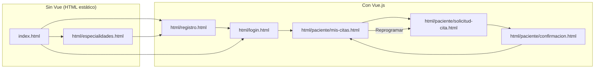
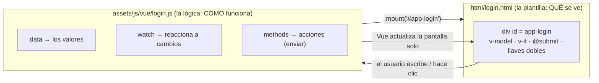
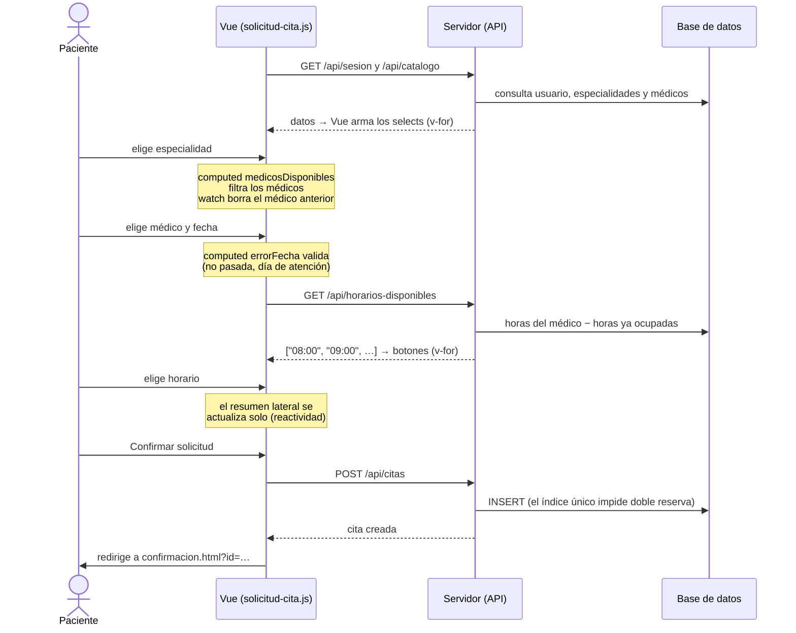
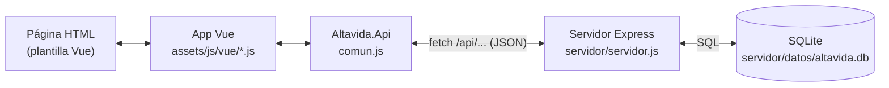

# Uso de Vue.js en Clínica Altavida

Guía para entender **dónde y cómo** se usa Vue.js en el proyecto, sin
necesidad de leer todo el código.

**Contenido**

1. [Resumen rápido](#1-resumen-rápido)
2. [Mapa: qué páginas usan Vue](#2-mapa-qué-páginas-usan-vue)
3. [Cómo se carga Vue](#3-cómo-se-carga-vue)
4. [Anatomía de una página con Vue (ejemplo: login)](#4-anatomía-de-una-página-con-vue-ejemplo-login)
5. [Directivas de Vue usadas y dónde](#5-directivas-de-vue-usadas-y-dónde)
6. [Componentes propios](#6-componentes-propios)
7. [Flujo completo: solicitar una cita](#7-flujo-completo-solicitar-una-cita)
8. [Cómo viajan los datos (Vue → servidor → base de datos)](#8-cómo-viajan-los-datos-vue--servidor--base-de-datos)
9. [Cómo agregar un formulario nuevo](#9-cómo-agregar-un-formulario-nuevo)

---

## 1. Resumen rápido

| Pregunta | Respuesta |
| --- | --- |
| ¿Qué versión? | Vue **3.4.38**, cargado desde CDN (sin instalar ni compilar nada). |
| ¿Dónde se usa? | Solo en las páginas con **formularios o datos**: login, registro y las 3 páginas del paciente. |
| ¿Dónde **no** se usa? | `index.html` y `html/especialidades.html` (son contenido estático). |
| ¿Dónde está el código? | Una carpeta: [`assets/js/vue/`](../assets/js/vue/) — un archivo por página + `comun.js`. |
| ¿Dónde está la plantilla? | Directamente en el HTML de cada página (atributos `v-…`, `@…`, `:…` y `{{ }}`). |

> **Idea clave:** cada página HTML tiene un contenedor con un `id="app-…"`.
> Su archivo `.js` crea una aplicación Vue y la "monta" en ese contenedor.
> A partir de ahí, Vue controla todo lo que está dentro.

---

## 2. Mapa: qué páginas usan Vue



| Página (plantilla) | Archivo Vue | Se monta en | Qué hace Vue ahí |
| --- | --- | --- | --- |
| [html/registro.html](../html/registro.html) | [registro.js](../assets/js/vue/registro.js) | `#app-registro` | Valida 5 campos, comprueba que las contraseñas coincidan, crea la cuenta. |
| [html/login.html](../html/login.html) | [login.js](../assets/js/vue/login.js) | `#app-login` | Valida, inicia sesión, muestra/oculta la contraseña. |
| [html/paciente/solicitud-cita.html](../html/paciente/solicitud-cita.html) | [solicitud-cita.js](../assets/js/vue/solicitud-cita.js) | `#app-solicitud` | Selects encadenados, validación de fecha, horarios libres, resumen en vivo. |
| [html/paciente/confirmacion.html](../html/paciente/confirmacion.html) | [confirmacion.js](../assets/js/vue/confirmacion.js) | `#app-confirmacion` | Muestra la cita recién creada (o un aviso si no existe). |
| [html/paciente/mis-citas.html](../html/paciente/mis-citas.html) | [mis-citas.js](../assets/js/vue/mis-citas.js) | `#app-mis-citas` | Lista las citas, filtro por estado, cancelación. |
| Las 3 páginas de paciente | [comun.js](../assets/js/vue/comun.js) | `#franja-sesion` | Franja "Sesión iniciada como…" y botón de cerrar sesión. |

---

## 3. Cómo se carga Vue

Al final de cada página con Vue hay **tres scripts, siempre en este orden**
(ejemplo de [html/login.html](../html/login.html#L89)):

```html
<script src="https://unpkg.com/vue@3.4.38/dist/vue.global.prod.js"></script> <!-- 1. Vue -->
<script src="../assets/js/vue/comun.js"></script>                            <!-- 2. Lo compartido -->
<script src="../assets/js/vue/login.js"></script>                            <!-- 3. La app de esta página -->
```

1. **Vue** crea la variable global `Vue`.
2. **comun.js** crea `window.Altavida` con lo que todas las páginas comparten.
3. **El archivo de la página** crea su aplicación y la monta.

Qué hay en [comun.js](../assets/js/vue/comun.js):

| Pieza | Para qué sirve |
| --- | --- |
| [`Api`](../assets/js/vue/comun.js#L53) | Todas las llamadas al servidor (`registrar`, `iniciarSesion`, `crearCita`, …). |
| [`Reglas`](../assets/js/vue/comun.js#L81) y [`validar()`](../assets/js/vue/comun.js#L101) | Reglas de validación reutilizables (obligatorio, correo, teléfono…). |
| [`<campo-formulario>`](../assets/js/vue/comun.js#L142) y [`<etiqueta-estado>`](../assets/js/vue/comun.js#L159) | Los dos componentes propios (ver sección 6). |
| [`requerirSesion()`](../assets/js/vue/comun.js#L180) | Protege las páginas del paciente: sin sesión, redirige al login. |
| [`montarFranjaSesion()`](../assets/js/vue/comun.js#L188) | La mini-app Vue de la franja superior. |

---

## 4. Anatomía de una página con Vue (ejemplo: login)

Una página con Vue tiene **dos mitades** que trabajan juntas:



### La plantilla (HTML)

```html
<!-- html/login.html -->
<div id="app-login" v-cloak>                                   <!-- ① Aquí se monta Vue -->
  <form @submit.prevent="enviar">                              <!-- ② Al enviar, llama a enviar() -->

    <p v-if="errorGeneral" class="aviso aviso--error">          <!-- ③ Solo aparece si hay error -->
      {{ errorGeneral }}                                       <!-- ④ Muestra el valor -->
    </p>

    <campo-formulario id="correo" etiqueta="Correo electrónico"
                      obligatorio :error="errores.correo">      <!-- ⑤ Componente propio -->
      <input type="email" id="correo"
             v-model.trim="formulario.correo"                  <!-- ⑥ Enlace en ambos sentidos -->
             @blur="validarCampo('correo')">                   <!-- ⑦ Valida al salir del campo -->
    </campo-formulario>

    <button type="submit" :disabled="enviando">                <!-- ⑧ Se desactiva mientras envía -->
      {{ enviando ? 'Ingresando…' : 'Ingresar' }}
    </button>
  </form>
</div>
```

### La lógica (JS)

```js
// assets/js/vue/login.js (simplificado)
var app = Vue.createApp({
  data: function () {                       // Los valores que usa la plantilla
    return {
      formulario: { correo: "", contrasena: "" },
      errores: {},
      errorGeneral: "",
      enviando: false
    };
  },
  methods: {
    validarCampo: function (campo) { /* usa Altavida.validar() */ },
    enviar: function () {
      this.errores = A.validar(this.formulario, esquema);  // 1. Valida en el navegador
      if (Object.keys(this.errores).length) return;          //    si hay errores, se detiene
      this.enviando = true;                                  // 2. El botón se desactiva solo
      A.Api.iniciarSesion(this.formulario.correo, this.formulario.contrasena)
        .then(function () { window.location.href = "paciente/mis-citas.html"; })
        .catch(function (e) { vm.errorGeneral = e.mensaje; }); // 3. El aviso aparece solo
    }
  }
});

A.registrarComponentes(app).mount("#app-login");  // Conecta la lógica con la plantilla
```

> **Lo importante:** en ningún lugar se escribe `document.getElementById(...)`
> ni se cambia el HTML a mano. Basta con cambiar `this.errorGeneral` o
> `this.enviando`: **Vue actualiza la pantalla automáticamente** (reactividad).

---

## 5. Directivas de Vue usadas y dónde

| Directiva | Qué hace | Ejemplo real | Se usa en |
| --- | --- | --- | --- |
| `{{ }}` | Muestra un valor como texto | `{{ cita.medico }}` | Todas |
| `v-model` | Enlaza un campo con un dato (en ambos sentidos) | `v-model="formulario.fecha"` | login, registro, solicitud-cita |
| `v-if` / `v-else` | Muestra u oculta un elemento según una condición | `v-if="errorGeneral"` | Todas |
| `v-for` | Repite un elemento por cada dato de una lista | `v-for="cita in citasFiltradas"` | solicitud-cita, mis-citas |
| `@submit.prevent` | Ejecuta un método al enviar, sin recargar la página | `@submit.prevent="enviar"` | login, registro, solicitud-cita |
| `@click` | Ejecuta código al hacer clic | `@click="cancelar(cita)"` | login, mis-citas, franja de sesión |
| `@blur` | Ejecuta código al salir de un campo | `@blur="validarCampo('correo')"` | login, registro |
| `:disabled` | Activa/desactiva un control según un dato | `:disabled="!formulario.especialidadId"` | login, registro, solicitud-cita |
| `:class` | Agrega clases CSS según condiciones | `:class="{ 'tarjeta-resumen__vacio': !medico }"` | solicitud-cita |
| `:key` | Identifica cada elemento de un `v-for` | `:key="cita.id"` | solicitud-cita, mis-citas |
| `v-cloak` | Oculta la plantilla hasta que Vue termina de cargar | `<main v-cloak>` | Todas |

Y las **opciones** de una app Vue que aparecen en los archivos `.js`:

| Opción | Qué es | Ejemplo en el proyecto |
| --- | --- | --- |
| `data` | Los valores de la página | `formulario`, `errores`, `citas` |
| `computed` | Valores **calculados** que se actualizan solos | [`medicosDisponibles`](../assets/js/vue/solicitud-cita.js#L43): médicos de la especialidad elegida |
| `watch` | Código que se ejecuta **cuando cambia** un dato | [Al cambiar la especialidad](../assets/js/vue/solicitud-cita.js#L85) se borra el médico elegido |
| `methods` | Acciones (enviar, cancelar, validar…) | [`enviar()`](../assets/js/vue/solicitud-cita.js#L140), `cancelar(cita)` |
| `mounted` | Se ejecuta una vez, al aparecer la página | Carga los horarios al reprogramar |

---

## 6. Componentes propios

Se registran en [comun.js](../assets/js/vue/comun.js#L169) y se usan como si
fueran etiquetas HTML nuevas.

### `<campo-formulario>`

Evita repetir en cada campo la etiqueta, el asterisco de obligatorio, el
texto de ayuda y el mensaje de error.

```html
<!-- Lo que se escribe en la página: -->
<campo-formulario id="telefono" etiqueta="Teléfono" obligatorio :error="errores.telefono">
  <input type="tel" id="telefono" v-model="formulario.telefono">
</campo-formulario>

<!-- Lo que Vue genera (cuando hay error): -->
<div class="campo campo--obligatorio campo--error">
  <label for="telefono">Teléfono</label>
  <input type="tel" id="telefono">
  <p class="campo__error">Ingresa un teléfono válido (7 a 15 dígitos).</p>
</div>
```

| Propiedad | Para qué |
| --- | --- |
| `id` | Une la etiqueta con el campo (`<label for>`) |
| `etiqueta` | Texto de la etiqueta |
| `obligatorio` | Agrega el asterisco rojo |
| `error` | Si tiene texto, se muestra en rojo y el campo se marca |
| `ayuda` | Texto gris debajo del campo (se oculta si hay error) |

### `<etiqueta-estado>`

Muestra el estado de una cita con su color.

```html
<etiqueta-estado :estado="cita.estado"></etiqueta-estado>
<!-- genera: <span class="etiqueta-estado etiqueta-estado--pendiente">Pendiente</span> -->
```

Se usa en [mis-citas.html](../html/paciente/mis-citas.html) y [confirmacion.html](../html/paciente/confirmacion.html).

---

## 7. Flujo completo: solicitar una cita

Es la página que más aprovecha Vue. Así reacciona a cada acción del paciente:



---

## 8. Cómo viajan los datos (Vue → servidor → base de datos)



- Vue **nunca** habla directamente con la base de datos: siempre pasa por
  `Altavida.Api` → servidor.
- Si el servidor responde con error, `Api` devuelve `{ mensaje, campos }`.
  Las apps Vue copian `campos` en `errores`, así el mensaje aparece **debajo del
  campo correcto** sin código extra.
- Las validaciones se hacen **dos veces**: en Vue (respuesta inmediata) y en el
  servidor (seguridad: no se confía solo en el navegador).

---

## 9. Cómo agregar un formulario nuevo

Pasos para crear, por ejemplo, una página de "Editar perfil":

**1. La plantilla** — `html/paciente/perfil.html`, con un contenedor y directivas:

```html
<div id="app-perfil" v-cloak>
  <form class="formulario" novalidate @submit.prevent="guardar">
    <campo-formulario id="telefono" etiqueta="Teléfono" obligatorio :error="errores.telefono">
      <input type="tel" id="telefono" v-model.trim="formulario.telefono">
    </campo-formulario>
    <button type="submit" class="boton boton--primario">Guardar</button>
  </form>
</div>

<script src="https://unpkg.com/vue@3.4.38/dist/vue.global.prod.js"></script>
<script src="../../assets/js/vue/comun.js"></script>
<script src="../../assets/js/vue/perfil.js"></script>
```

**2. La lógica** — `assets/js/vue/perfil.js`:

```js
(function () {
  var A = window.Altavida;

  var app = Vue.createApp({
    data: function () {
      return { formulario: { telefono: "" }, errores: {} };
    },
    methods: {
      guardar: function () {
        this.errores = A.validar(this.formulario, {
          telefono: [A.Reglas.obligatorio, A.Reglas.telefono]
        });
        if (Object.keys(this.errores).length) return;
        // A.Api.… llamada al servidor
      }
    }
  });

  A.registrarComponentes(app).mount("#app-perfil");
})();
```

**3. Si necesita datos nuevos**, agregar la función en `Api` ([comun.js](../assets/js/vue/comun.js#L53))
y su ruta en [servidor/servidor.js](../servidor/servidor.js).

### Errores comunes

| Síntoma | Causa | Solución |
| --- | --- | --- |
| Se ven los `{{ }}` en la página | Vue no cargó (sin internet o script mal escrito) | Revisar el orden de los 3 scripts y la consola del navegador. |
| El formulario recarga la página | La directiva `@submit.prevent` está en el **mismo** elemento donde se monta Vue | Montar Vue en un `<div>` que **envuelva** al `<form>`. |
| "Esta página no está conectada al servidor…" | Se abrió con Live Server | Ejecutar `npm start` y entrar por `http://localhost:3000`. |
| Un componente no aparece | Faltó `A.registrarComponentes(app)` antes de `.mount()` | Agregarlo. |
